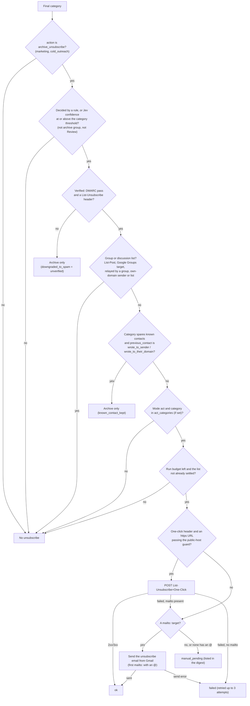

# How inbox-jev decides

This is the functional spec of the triage logic: what happens to one email, which signals are
checked, and why. Everything here describes the code on `main` (`src/inbox_jev/`) and the shipped
[`categories.yaml`](../categories.yaml). Numbers are the shipped defaults; where a setting can
change them, the setting is named.

- The design decisions behind these rules, with the alternatives that were rejected, are in
  [`docs/decisions/`](decisions/README.md).
- Every worked example below (`EX-NN`) has a test with the same ID in
  [`tests/test_spec_examples.py`](../tests/test_spec_examples.py) that runs the real code. A test
  fails if an ID exists on only one side.
- **Changing decision logic?** Update this document, the matching examples and tests, and add an
  ADR when it is a design decision, in the same PR (see [CLAUDE.md](../CLAUDE.md)).

Contents:

1. [The pass over an inbox](#1-the-pass-over-an-inbox)
2. [The per-email pipeline](#2-the-per-email-pipeline)
3. [Decision tables](#3-decision-tables)
4. [What it checks and how](#4-what-it-checks-and-how)
5. [Worked examples](#5-worked-examples)
6. [Glossary](#6-glossary)

## 1. The pass over an inbox

`inbox-jev run` (`triage.run_account`) handles one account:

1. The **mode** is `--mode`, else the account's `mode`, else `MODE` from `.env` (default
   `dry_run`). An `act_categories` key that isn't in `categories.yaml` fails the account's run
   before anything is touched.
2. In `label` and `act`, the Jev labels are created in Gmail if missing.
3. In `label` and `act`, **corrections** are checked first (`corrections.check`, see
   [3.7](#37-corrections-user-edits-and-restore)).
4. Gmail lists inbox message ids with `newer_than:<LOOKBACK>` (default `2d`, `run --lookback`
   overrides it), at most `MAX_MESSAGES_PER_RUN` (default 200, `run --limit` overrides it).
5. A listed email is **skipped** when its stored row is `restored`, or is `done` in the current
   mode or a stronger one. So an email seen in `dry_run` is processed again by `label` or `act`,
   and one seen in `label` is processed again by `act`. Rows with `status = error` are retried
   on every run while they are still listed.
6. Each remaining email goes through the [pipeline](#2-the-per-email-pipeline). An exception
   rolls back that email, stores it as `status = error` and the run continues.
7. One unsubscribe budget is shared by the whole run: `MAX_UNSUBSCRIBES_PER_RUN` (default 20)
   attempts.

## 2. The per-email pipeline

`triage.process`, one email at a time:

```mermaid
flowchart TD
    A["Fetch the full message (gmail.get)<br/>headers, body (extract_body), snippet"] --> B["Signals from headers (signals.extract)<br/>then resolve_relay with group_domains"]
    B --> C{"Row seen in an earlier label/act pass<br/>and mode is not dry_run?"}
    C -- yes --> D{"Changed Jev category label<br/>or pulled back to INBOX?"}
    D -- yes --> D2["Record correction<br/>(sender rule, source correction)"]
    D -- no --> E
    D2 --> E{"User edit?<br/>starred, our label removed,<br/>another Jev label added"}
    E -- yes --> STOP["Hands off: mark done, change nothing in Gmail"]
    E -- no --> F
    C -- no --> F["Look up sender rule<br/>(exact address, then @domain)"]
    F --> G{"Allowlisted?<br/>author in allow_senders/allow_domains,<br/>or group address in allow_senders"}
    G -- yes --> DEC
    G -- no --> H{"Active sender rule?"}
    H -- no --> I["previous_contact (sent-mail search)<br/>then ask Jev (build_state)"]
    H -- yes --> J{"Rule would unsubscribe<br/>a category that spares known contacts?"}
    J -- yes --> K["previous_contact (sent-mail search)"]
    J -- no --> DEC
    I --> DEC
    K --> DEC
    DEC["policy.decide<br/>allowlist / rule / threshold / archive group / Review<br/>+ Needs Reply and tag labels"] --> PL["policy.plan<br/>mode + act_categories"]
    PL --> AP["Gmail modify: add labels, remove INBOX (archive/spam),<br/>add SPAM, drop stale labels from an earlier pass"]
    AP --> DB["Store the row (category, confidence, probabilities, labels...)"]
    DB --> AR{"Jev answered?"}
    AR -- yes --> AR2["rules.record_auto<br/>(count toward / reset an auto rule)"]
    AR -- no --> U
    AR2 --> U{"plan.unsubscribe and run budget left?"}
    U -- yes --> U2["Unsubscribe once per list<br/>(see the unsubscribe flow)"]
    U -- no --> LOG
    U2 --> LOG["Commit and log 'message processed'<br/>(incl. previous_contact, archive_group)"]
```

The unsubscribe decision, across `policy.decide`, `policy.plan`, `triage._unsubscribe` and
`unsubscribe.unsubscribe`:

The chart shows the **rule path** order (`policy.decide`, rule branch): verified (C), then group
(D), then known contact (E). On the **Jev path** `policy.decide` checks E first: when the category
action is `archive_unsubscribe`, Jev is at or above the threshold and the sender is a known
contact, a category that spares known contacts sets `known_contact_kept` even if the sender is
unverified or a group. The email is archived only either way, but `known_contact_kept` stops the
answer counting toward an auto rule (see [Known gaps](#known-gaps)).

## 3. Decision tables

### 3.1 Categories

From `categories.yaml`. An account can raise or lower any threshold with `min_confidence:
{category: value}` in `accounts.yaml`.

| Category | Label | `action` | `min_confidence` | Notes |
|---|---|---|---|---|
| `important` | `Jev/Important` | keep | 0.0 | Allowlist target. Also the fallback for an answer naming an unknown category. |
| `action_required` | `Jev/Action` | keep | 0.0 | Own digest section. Includes a held message pending your approval. |
| `transactional` | `Jev/Transactional` | archive | 0.80 | |
| `notification` | `Jev/Notifications` | archive | 0.80 | Includes groups' held-spam reports. |
| `newsletter` | `Jev/Newsletters` | archive | 0.80 | |
| `marketing` | `Jev/Marketing` | archive_unsubscribe | 0.90 | `unsubscribe_known_contacts: true` (default). |
| `cold_outreach` | `Jev/Outreach` | archive_unsubscribe | 0.90 | `unsubscribe_known_contacts: false`. |
| `spam` | `Jev/Spam` | spam | 0.90 | Fraud only: scams, phishing, forged authentication. |

Extra labels:

| Label | When |
|---|---|
| `Jev/Needs Reply` | Jev's `needs_reply` ≥ 0.7 (`needs_reply.threshold`) **and** the decision doesn't archive or spam the email. Never on rule or allowlist decisions (Jev isn't asked). |
| `Jev/Invoices` | Tag `invoice_to_pay` ≥ 0.8. Added whatever the category, archived or not. Never on rule or allowlist decisions. |
| `Jev/Review` | The decision is low confidence (below the threshold and no archive group), or Jev named a category that doesn't exist. |
| `Jev/Processed` | Every email labeled in `label` or `act` mode. |

With the shipped thresholds (0.0), a keep answer is always applied and never goes to Review.

### 3.2 Confidence outcomes (Jev path)

`threshold` = the account's `min_confidence` for the category, else the category's own.

| Situation | Outcome | Unsubscribe | Spam |
|---|---|---|---|
| Jev's category isn't in `categories.yaml` | `important`, confidence 0.0, `Jev/Review` (low confidence) | no | no |
| `confidence ≥ threshold` | The category's action: keep, archive, archive + unsubscribe checks, or spam | only after the [unsubscribe checks](#33-unsubscribe-conditions) | `spam` category only |
| Below threshold and the **archive group** holds (next table) | Archived under the top category, `archive_group = true`, no Review | **never** | **never** |
| Otherwise | Stays in the inbox with `Jev/Review` + the suggested category label (`low_confidence = true`) | no | no |

**Archive group** (`policy._archive_group_confident`). All of these must hold:

| # | Condition | Shipped value |
|---|---|---|
| 1 | `archive_group_min_confidence` is set (remove it to disable the group) | 0.90 |
| 2 | Jev's top category has action `archive` or `archive_unsubscribe` (spam and keep categories never use the group) | |
| 3 | Needs-reply veto doesn't apply. It applies when `needs_reply ≥ 0.7` **and** either `previous_contact` is `wrote_to_sender` / `wrote_to_their_domain`, or the keep categories (`important` + `action_required`) together reach `archive_group_reply_keep_probability` | 0.05 |
| 4 | Floor = max(`archive_group_min_confidence`, the top category's `threshold`): the group never lowers a bar | 0.90 |
| 5 | The probabilities of the counted categories add up to the floor or more. A category counts when its action is `archive`/`archive_unsubscribe`, it is in `act_categories` (when the account sets it), and it is the top category or its **account-level** `min_confidence` (default 0.0) is at most the floor | |

`archive_group_reply_keep_probability` must be at most `1 - archive_group_min_confidence`
(config load fails otherwise): the group only fires when the archive categories hold ≥ 0.90, so
the keep categories hold ≤ 0.10 and a higher value could never be reached. `0` means any reply
signal blocks the group.

When the veto applies, the email falls through to Review, and since it isn't archived it also
gets `Jev/Needs Reply`.

### 3.3 Unsubscribe conditions

An unsubscribe is irreversible. During `run` it happens only when **all** of these hold:

| # | Condition | Where |
|---|---|---|
| 1 | The final category's action is `archive_unsubscribe` | `policy._apply` |
| 2 | Decided by a sender rule, or by Jev at or above the category threshold. An archive-group or Review decision never unsubscribes | `policy.decide` |
| 3 | **Verified**: `dmarc=pass` in Gmail's `Authentication-Results` and a `List-Unsubscribe` header with an `https:` or `mailto:` URI. If not, the email keeps its category, is archived, and `downgraded_to_spam` is set ("unsubscribe skipped: unverified sender"). It is never moved to Spam for this | `policy._verified` |
| 4 | **Not a group or discussion list** (`_group_list`): no `List-Post` header; no unsubscribe target on `googlegroups.com` / `groups.google.com` (host or subdomain); not relayed by a Google Group (`group_author` found, trusted or not); sender domain and `List-Id` not on the account's own domain (or a subdomain) | `policy._group_list` |
| 5 | For a category with `unsubscribe_known_contacts: false` (`cold_outreach`): `previous_contact` is not `wrote_to_sender` / `wrote_to_their_domain`. Unknown (`None`, the search failed or wasn't run) does **not** block it | `policy.decide` |
| 6 | Mode is `act`, and the account has no `act_categories` or lists the category | `policy.plan` |
| 7 | The run's budget (`MAX_UNSUBSCRIBES_PER_RUN`, 20) has attempts left | `triage.process` |
| 8 | The list isn't **settled**: no `unsubscribes` row for `(account, list_key)`, or its row is `failed` with fewer than 3 attempts | `triage._unsubscribe` |
| 9 | `dmarc_pass` again, inside the unsubscriber (defence in depth) | `unsubscribe.unsubscribe` |

The same checks run on the **rule path**: a sender rule skips Jev, not the sender checks. For a
rule to a category that spares known contacts, `triage` runs the sent-mail search only when the
answer could change the outcome (`_rule_needs_contact`: act mode, category acted on, verified,
not a group, list not settled).

A `failed` row is retried by `run` the next time an email from the same list passes all the
checks (until 3 attempts), and by `inbox-jev unsubscribe-retry`.

**`unsubscribe-retry`** (`triage.retry_unsubscribes`) re-checks each `failed` row with fewer than
3 attempts against the email's current state. Differences from `run`:

| Check | `run` | `unsubscribe-retry` |
|---|---|---|
| Mode not `act` | No unsubscribe | Every row held: `held: mode is …` |
| Stored message missing | n/a | held |
| Row restored or `corrected_category` set | Restored: never processed again. Corrected: the correction rule decides | `skipped` (before any Gmail call) |
| Run cap | 20 per run | 20 per call; extra rows held |
| Email deleted (404) | n/a | held; any other Gmail error is raised |
| `SPAM` or `TRASH` label in Gmail | n/a | `skipped` |
| Correction visible in live labels, or a user edit (starred, our label removed, another Jev label added) | Correction learned / hands off | `skipped` |
| Category | Current rule, else Jev | Current rule (if its category exists), else the stored category |
| Current rule points to a non-unsubscribing category | Rule decides | `skipped` |
| Stored category from a rule that was since deleted | Jev is asked again | held: `rule since removed` |
| Stored Jev category | Jev's fresh answer vs threshold | Stored confidence must still be ≥ the current threshold (account override included) and not `low_confidence`; else held |
| Category not unsubscribing or not in `act_categories` | No unsubscribe | held |
| Allowlisted sender | No Jev, `important` | `skipped` |
| Unverified, group or own list | No unsubscribe | `skipped` |
| Known contact (`cold_outreach`) | No unsubscribe | `skipped` |
| Sent-mail search fails (`None`) | **Unsubscribe goes ahead** | **held**: nothing in a manual retry is urgent |

`skipped` rows get `error = "retry: <reason>"` and are settled, so `run` won't retry them either.
Held rows stay `failed`.

### 3.4 Groups and mailing lists

| Case | Sender used for rules, allowlist, `previous_contact`, DB, digest | Jev state | Unsubscribe |
|---|---|---|---|
| Direct mail | `From` address | `from` header | Per [3.3](#33-unsubscribe-conditions) |
| Google Group on a domain in the account's `group_domains`, with the [trust checks](#45-x-original-sender-trust) passing | The author (`X-Original-Sender`); `relayed_by` = group address | adds `original_sender` and `sent_via_group` | **Never** |
| Google Group on any other domain (incl. `@googlegroups.com`, public providers), or trust checks failing | The group address (`From`) | `from` header only | **Never** if `X-Original-Sender` was a candidate, a `List-Post` is present, the target is Google Groups, or the group is on your own domain; else per 3.3 |
| Mail the group itself sends (held-spam report, moderation notice): no `X-Original-Sender` | The group address | `from` header | Per 3.3; never for a group on your own domain |
| Other discussion lists (Mailman, groups.io, LISTSERV, Discourse) | `From` (the list) | `from` header | **Never** (`List-Post`) |
| ESP / sequence tool (Mailchimp, Instantly…) | `From` | `from` header | Per 3.3 (they don't send `List-Post`) |

- `group_domains` is opt-in and empty by default, not even the account's own domain. Entries are
  normalised (lowercase, no trailing dot, no leading `@`) and rejected when they aren't a domain,
  are a bare public suffix like `co.uk` / `com.ar`, or are (or end in) a public mail provider,
  `googlegroups.com` or `groups.google.com`.
- **Allowlist**: `allow_senders` / `allow_domains` are matched against the resolved sender. For a
  trusted group that is the author, so `allow_domains: [yourco.com]` does **not** trust strangers
  writing to `hello@yourco.com`; put the group's exact address in `allow_senders` to allowlist
  it. For an untrusted group the sender is the group address, so an `allow_domains` entry for the
  group's domain allowlists everything sent through it.
- Rules and corrections for a trusted group key on the author; untrusted groups stay keyed on the
  group address, never on the author they claim.
- `list_key` (once per list) is `List-Id`, else the sender domain.

### 3.5 Sender rules

| Rule source | Created by | Key | Overrides |
|---|---|---|---|
| `manual` | `inbox-jev rules set -a EMAIL SENDER CATEGORY` | address or `@domain` | Replaces any rule on the same key (`rules.set_rule`), including correction and auto rules |
| `correction` | A detected correction ([3.7](#37-corrections-user-edits-and-restore)) | exact resolved sender address | Replaces any rule on the same key |
| `auto` | `rules.record_auto` after consistent Jev answers | exact resolved sender address | Never changes manual/correction rules |

- Lookup: active rule on the exact address, else on `@domain` (`policy.rule_keys`). Allowlist wins
  over rules.
- A rule decision has source `rule`, confidence 1.0, and no Jev call: no `needs_reply`, no tags,
  no `previous_contact` unless the unsubscribe needs it.
- A rule whose category no longer exists in `categories.yaml` makes processing of that sender's
  email fail (see [Known gaps](#known-gaps)); delete such rules when removing a category.

**Automatic rules** (`rules.record_auto`, Jev path only; any mode, including `dry_run`):

| Step | Condition | Effect |
|---|---|---|
| Reset | The decision is a keep category, **or** the keep categories other than the decided one hold ≥ `auto_rule.max_keep_probability` (0.02) — even on a low-confidence answer — **and** the sender has a pending (inactive) `auto` rule to a non-keep category | `hits = 0` |
| Doesn't count | `low_confidence`, `archive_group`, `known_contact_kept`, the keep signal above, or Jev's confidence < `auto_rule.min_confidence` (0.95) | nothing more |
| Counts, no rule yet | | new `auto` rule, `hits = 1`, active if `auto_rule.hits` ≤ 1 |
| Counts, rule is manual/correction or already active | | unchanged |
| Counts, same category | | `hits += 1`; active at `auto_rule.hits` (3) |
| Counts, other category | | category switches, `hits = 1` |

Unverified senders (`downgraded_to_spam`) can earn a rule, unless they are also a known contact
in a category that spares known contacts (`cold_outreach`): the Jev path sets
`known_contact_kept` before the verified check (see [Known gaps](#known-gaps)). The rule path
re-runs the DMARC/`List-Unsubscribe`/group checks on each email. Keep categories can earn a rule
too.

### 3.6 Modes and `act_categories`

`policy.plan`:

| Mode | DB + digest | Gmail labels | Archive / spam / unsubscribe |
|---|---|---|---|
| `dry_run` | yes | no | no |
| `label` | yes | yes (+ `Jev/Processed`) | no |
| `act` | yes | yes | yes |
| `act`, category not in the account's `act_categories` | yes | yes | no (treated as `label`) |

- `act_categories` is matched against the **final** category. Absent = every category acts; `[]`
  = none; an empty key (`act_categories:` with nothing) is rejected at load.
- In `act`, archive removes `INBOX`; spam removes `INBOX` and adds `SPAM` (the row is `spammed`,
  not `archived`).
- When an email is processed again (weaker mode before, or `reprocess`), labels from the earlier
  pass that the new plan doesn't add are removed (never `SPAM`).
- `inbox-jev reprocess -a EMAIL --category KEY [--low-confidence-only]` sets act rows that are
  `done`, not archived, spammed or restored, back to `label`, so the next `act` run (within its
  `--lookback`) redoes them.

### 3.7 Corrections, user edits and restore

**What counts as a correction** (`corrections.detect`, given the email's current labels):

| Current state in Gmail | Correction to |
|---|---|
| Exactly one Jev category label, different from the stored category | That category |
| Exactly one Jev category label, the stored one, the row was low confidence and `Jev/Review` was removed | The stored category ("accepted the suggestion") |
| Archived or spammed by us and back in `INBOX`, when neither row above applies | `important` |
| Two or more category labels, or none, and not pulled back | none |

A correction sets `corrected_category` on the row and a `correction` sender rule (active) on the
row's stored sender. It is checked in two places:

- `corrections.check`, at the start of every `label`/`act` run: rows that are `done`, not
  `dry_run`, not restored, not yet corrected, processed in the last **7 days**, and not checked
  in the last **hour**; newest first, at most **100** per run. Deleted emails are skipped.
- In the pipeline, when an email from an earlier `label`/`act` pass is processed again.

**User edits = hands off** (`triage._user_edit`, only for rows that have labels from an earlier
pass, and never in `dry_run`):

| Edit | Result |
|---|---|
| Email is starred | Hands off, **even after a correction** |
| Row has a correction | Processed again: the new correction rule decides |
| A label we added (other than `Jev/Processed`) was removed | Hands off |
| A Jev label we didn't add (category, `Jev/Needs Reply`, `Jev/Review`, tag) is present | Hands off |

"Hands off" means: the row is marked `done` in the current mode, nothing changes in Gmail and the
email isn't revisited in that mode. A starred **new** email (no earlier pass) is processed normally.

**Restore** (`inbox-jev restore -a EMAIL --since 1d [--category K]`): for `label`/`act` rows in the
window, moves archived/spammed emails back to the inbox, removes our labels and `SPAM`, and marks
them `restored`. Restored emails are never processed again, aren't learned as corrections, and
their failed unsubscribes are `skipped` by `unsubscribe-retry`. Unsubscribes can't be undone.

## 4. What it checks and how

### 4.1 `previous_contact`

`triage.previous_contact(gmail, account, sender)` returns `wrote_to_sender`,
`wrote_to_their_domain`, `never`, or `None` (unknown):

1. The sender (resolved: a trusted group's author) is lowercased and must match
   `^[a-z0-9._%+-]+@[a-z0-9.-]+\.[a-z]{2,}$`. Otherwise `None` with no query (odd characters would
   change the search).
2. Gmail search `in:sent to:<sender>` (`maxResults=1`). A hit → `wrote_to_sender`.
3. Unless the sender's domain is a free-mail provider (`gmail.com`, `googlemail.com`,
   `outlook.com`, `hotmail.com`, `live.com`, `msn.com`, `yahoo.com`, `icloud.com`, `me.com`,
   `aol.com`, `proton.me`, `protonmail.com`, `gmx.com`) or the account's own domain: search
   `in:sent to:<domain>`. A hit → `wrote_to_their_domain`.
4. Otherwise `never`.

Each query's answer is cached in the `Gmail` object, so per account per run. Any exception →
`None` (logged as a warning, not cached).

When it runs: on the Jev path for every email (in every mode, including `dry_run`), and on the
rule path only when `_rule_needs_contact` says it can change an unsubscribe. Never for
allowlisted senders.

Consequences of each value:

| Value | Jev state | Needs-reply veto on the archive group | `cold_outreach` unsubscribe (`run`) | `unsubscribe-retry` | Auto rule |
|---|---|---|---|---|---|
| `wrote_to_sender` / `wrote_to_their_domain` | sent | any reply signal vetoes | no (`known_contact_kept`) | `skipped` | doesn't count in a category that spares known contacts, even when the sender is unverified or a group ([Known gaps](#known-gaps)) |
| `never` | sent | only with keep probability ≥ 0.05 | yes | proceeds | normal |
| `None` | key left out | only with keep probability ≥ 0.05 | **yes** (other checks still apply) | **held** | normal |

The value is logged on the "message processed" line; it isn't stored in the DB.

### 4.2 DMARC

`signals.dmarc_passed(Authentication-Results headers)`: Gmail prepends its own
`Authentication-Results`, and a sender can inject more (even ones claiming `mx.google.com`).
Only the **topmost** header that starts with `mx.google.com` is trusted. Every `dmarc=` verdict in
it must be `pass`, and there must be at least one. If no header starts with `mx.google.com`, all
the headers are used with the same rule.

### 4.3 `List-Unsubscribe`, one-click and `mailto:`

- `List-Unsubscribe` (first header) is parsed as RFC 2369 `<uri>` entries. Only `https://` and
  `mailto:` URIs are kept; `http://` and anything else is ignored. "Has unsubscribe" = at least
  one of them.
- **One-click** = `List-Unsubscribe-Post` contains `List-Unsubscribe=One-Click` (spaces and case
  ignored) and there is at least one `https` URI.
- Order in `unsubscribe.unsubscribe`:
  1. `dmarc_pass` is false → `manual`/`skipped` (never reached from `run`, which checks first).
  2. With one-click: the first `https` URL that passes the guard gets a `POST` with form body
     `List-Unsubscribe=One-Click`, 15 s timeout, **no redirects**. A 2xx or 3xx is `ok`. If it
     fails and a `mailto:` exists, go to step 3; if it fails and none exists, `failed`. URLs that
     fail the guard are skipped.
  3. The first `mailto:` with an `@` gets an email from your Gmail (subject and body from the
     URI, default `unsubscribe`). Sent → `ok`; error → `failed`.
  4. Otherwise `manual_pending` with the first `https` URL as target (listed in the digest).
- **URL guard** (`is_public_https`): scheme `https`, a hostname, and every address it resolves to
  is global (no private, loopback or link-local IPs); a DNS failure rejects it.
- Links in the body are never followed.

### 4.4 `List-Post`

Any non-empty `List-Post` header marks a discussion list (RFC 2369; set by Google Groups, Mailman,
groups.io, LISTSERV, Discourse; not by ESPs or sequence tools). Its `List-Unsubscribe` would
remove *you* from the list, so it is never used.

### 4.5 `X-Original-Sender` trust

`signals.original_sender` records a candidate author (`group_author`) only when:

- `dmarc=pass` for the message (so for the group's `From` domain);
- the first `Mailing-list` header starts with `list <address>` and that address equals the
  `From` address;
- `X-Original-Sender` is a valid address different from `From`.

`signals.resolve_relay` then moves the candidate into `sender` (and the group into `relayed_by`)
only when the `From` domain is one of the account's `group_domains` or a subdomain of one. Any
candidate, trusted or not, makes the email a group for the unsubscribe check.

### 4.6 Body extraction

`gmail.extract_body(payload)` walks the MIME tree:

- Parts with a filename (attachments) are skipped.
- Within each `multipart/alternative` that has a `text/plain` part, its plain text is used,
  **unless it is a stub**: plain text shorter than **300** characters (URLs removed before
  counting) next to HTML whose stripped text (URLs removed) is at least **3×** as long, with a
  minimum of 3 × 20 = **60** characters. An empty plain part always yields to its HTML. The check
  only compares an alternative's own plain and HTML versions, so a note you wrote above a
  forwarded HTML message is never dropped.
- At the top level, all text segments are joined. Only when there is no text at all are the
  remaining HTML parts (those not already resolved inside an alternative) stripped and used.
- HTML is stripped by dropping `<script>`, `<style>` and `<head>` content, joining text nodes with
  spaces and unescaping entities.
- Normalisation: runs of spaces, tabs, no-break spaces (U+00A0) and zero-width non-joiners
  (U+200C) become one space; trailing whitespace before a newline is removed; the result is
  stripped.

If the body is empty after all that, Jev gets Gmail's `snippet` (HTML-unescaped) instead.

### 4.7 What Jev receives

`classifier.build_state` sends:

| Key | Value |
|---|---|
| `recipient` | The account's address |
| `from`, `to`, `cc`, `subject` | First header value (raw; for a group, `from` shows the group) |
| `date` | Gmail's internal date, ISO 8601 UTC |
| `is_mailing_list` | `List-Id` present or a usable `List-Unsubscribe` (`https`/`mailto`) |
| `precedence` | `Precedence` header or null |
| `body` | Extracted body, else the snippet, first `BODY_CHARS` (3000) characters |
| `original_sender`, `sent_via_group` | Only for a trusted group relay: the author and the group |
| `previous_contact` | Only when known (`None` leaves the key out) |

Questions (`build_questions`): one `Choice` over the categories, with each category's `criteria`
and the instruction to judge by who wrote it and why, explaining `previous_contact` ("a
personal-looking pitch from a sender I never wrote to is usually cold outreach"); one `Noul` for
`needs_reply`; one `Noul` per tag. The answer gives the category, its confidence, every
category's probability, `needs_reply` and the tag probabilities.

## 5. Worked examples

Addresses are fictional. The account is `me@example.com` with `group_domains: [example.com]`,
no allowlist unless stated, shipped `categories.yaml`, `MODE=act`, no `act_categories`. Only
the probabilities that matter are shown; the rest are ~0.

### EX-01 — Tool digest split between notification and newsletter

- **Test**: `test_ex01_tool_digest_split_is_archived_by_the_group`
- **Input**: weekly product-analytics digest from `digest@analytics.example`. Jev: notification
  0.55, newsletter 0.42, marketing 0.02, important 0.01; `needs_reply` 0.05.
- **Outcome**: archived as `notification` with `Jev/Notifications`; `archive_group = true`; no
  Review, no unsubscribe; doesn't count toward an auto rule.
- **Why**: notification alone (0.55) is below 0.80, but the archive categories add up to 0.99 ≥
  the floor max(0.90, 0.80). Jev is sure the email goes away, just not under which label. With
  `act_categories: [notification]`, only notification would count (0.55) and the email would go
  to Review.

### EX-02 — Automated payment approval

- **Test**: `test_ex02_payment_approval_stays_with_action_label`
- **Input**: `alerts@bank.example`, "Approve payment to Acme Supplies". Jev: action_required 0.93,
  transactional 0.05, important 0.02; `needs_reply` 0.85.
- **Outcome**: stays in the inbox with `Jev/Action` and `Jev/Needs Reply`; listed in the digest's
  `Jev/Action` section (and not repeated under "needs reply").
- **Why**: `action_required` is a keep category (threshold 0.0). Needs Reply is added because the
  email isn't archived. The answer doesn't count toward an auto rule (0.93 < 0.95, and important
  0.02 is a keep signal), so this sender keeps going through Jev.

### EX-03 — Bulk event newsletter with a "client doesn't support HTML" stub

- **Test**: `test_ex03_stub_plain_part_is_replaced_by_the_html`
- **Input**: `multipart/alternative` from an ESP: `text/plain` = "Your mail client does not
  support HTML messages. Copy and paste this URL into your browser:" plus a ~250-character
  tracking URL; `text/html` = the event's agenda and speakers. Jev (on the HTML text):
  newsletter 0.91, marketing 0.09.
- **Outcome**: Jev gets the HTML's text as `body`; archived as `newsletter` on its own confidence
  (not through the group).
- **Why**: the plain part is under 300 characters once the URL is removed, and its HTML sibling
  has more than 3× (and ≥ 60) characters of text. Before this rule Jev classified the stub blind
  (split cold_outreach / spam / marketing → Review). A short real reply next to similar HTML is
  kept as is.

### EX-04 — Cold-outreach sequence from a stranger, RFC 8058 headers

- **Test**: `test_ex04_stranger_sequence_is_archived_and_unsubscribed`
- **Input**: `sam@growthagency.example`, "Re: quick question about your pipeline". DMARC pass,
  `List-Unsubscribe: <https://unsub.sequencer.example/u/abc>, <mailto:unsub@growthagency.example>`,
  `List-Unsubscribe-Post: List-Unsubscribe=One-Click`, no `List-Post`. `previous_contact` =
  `never` (both searches empty). Jev: cold_outreach 0.96.
- **Outcome**: archived with `Jev/Outreach`; one-click `POST` to the https URL; `unsubscribes` row
  `one_click` / `ok`; the `mailto:` isn't used.
- **Why**: cold_outreach ≥ 0.90, verified sender, not a group, a stranger, act mode, budget left,
  list not settled. Sequence tools stop the sequence on unsubscribe.

### EX-05 — The same sequence from someone you wrote to

- **Test**: `test_ex05_known_contact_sequence_is_archived_only`
- **Input**: as EX-04, but your sent mail has an email to `sam@growthagency.example`
  (`previous_contact` = `wrote_to_sender`; `wrote_to_their_domain` behaves the same).
- **Outcome**: archived with `Jev/Outreach`; **no** unsubscribe (`known_contact_kept`); the answer
  doesn't count toward an auto rule.
- **Why**: `cold_outreach` has `unsubscribe_known_contacts: false`. A "pitch" from a known contact
  is where Jev is most likely wrong, and an opt-out can cover all of that company's mail. Keeping
  the sender on the Jev path means the relationship is seen on every email.

### EX-06 — A pitch relayed by your own Google Group

- **Test**: `test_ex06_pitch_via_own_group_uses_author_and_never_unsubscribes`
- **Input**: `From: "'Dana' via Hello" <hello@example.com>`, `X-Original-Sender:
  dana@pitchco.example`, `Mailing-list: list hello@example.com; contact
  hello+owners@example.com`, `List-Id: <hello.example.com>`, `List-Post:
  <mailto:hello@example.com>`, `List-Unsubscribe:
  <mailto:googlegroups-manage+1+unsubscribe@googlegroups.com>`, DMARC pass. The account also has
  `allow_domains: [example.com]`. Jev: cold_outreach 0.97.
- **Outcome**: sender = `dana@pitchco.example` (Jev gets `original_sender` and `sent_via_group`;
  `previous_contact` searches for Dana; the DB, digest and any auto rule use Dana). Archived with
  `Jev/Outreach`; **never** unsubscribed.
- **Why**: `example.com` is in `group_domains` and the trust checks pass, so the author is
  recovered. `allow_domains` matches the author, not the group, so the stranger isn't allowlisted.
  The `List-Unsubscribe` would remove *you* from `hello@`: relayed mail, `List-Post`, a Google
  Groups target and an own-domain list are each enough to block it.

### EX-07 — Google Groups held-spam report

- **Test**: `test_ex07_held_spam_report_is_archived_as_notification`
- **Input**: the group's "Moderator's spam report" for `hello@example.com`, sent by the group
  itself (no `X-Original-Sender`). Jev: notification 0.90, action_required 0.06.
- **Outcome**: archived with `Jev/Notifications` (an `archive` category: no unsubscribe).
- **Why**: the `notification` criteria include automated held-spam reports and `action_required`
  excludes them. A sender rule would be the wrong fix: the sender is the group, which also
  carries real mail. (If `allow_domains` covered `example.com`, the group address itself would be
  allowlisted and the report would stay as `important`.)

### EX-08 — Google Groups pending-approval notice

- **Test**: `test_ex08_pending_approval_notice_stays_actionable`
- **Input**: "A message to hello@example.com is pending your approval", sent by the group. Jev:
  action_required 0.96, notification 0.03; `needs_reply` 0.75.
- **Outcome**: stays in the inbox with `Jev/Action` and `Jev/Needs Reply`.
- **Why**: `action_required` explicitly covers a held message pending your approval: it is the
  only way a non-member (a prospect writing to `hello@`) gets delivered.

### EX-09 — Mass "free consultation" pitch that "expects a reply"

- **Test**: `test_ex09_mass_pitch_expecting_reply_is_group_archived`
- **Input**: "Get Your Free Consultation Today!" from a bulk sender, `previous_contact` = `never`.
  Jev: cold_outreach 0.67, marketing 0.31, important 0.00, action_required 0.00; `needs_reply`
  0.79.
- **Outcome**: archived as `cold_outreach` through the archive group; no Review, no
  `Jev/Needs Reply`, no unsubscribe.
- **Why**: archive categories sum to 0.98 ≥ 0.90. `needs_reply` ≥ 0.7, but the sender is not a
  known contact and the keep categories (0.00) are below 0.05, so the veto doesn't apply: every
  pitch "expects a reply". The group never unsubscribes (0.67 < 0.90).

### EX-10 — A known vendor's sales follow-up that expects a reply

- **Test**: `test_ex10_known_vendor_follow_up_stays_in_review`
- **Input**: same answer as EX-09 (cold_outreach 0.67, marketing 0.31; `needs_reply` 0.79), but
  from `rep@vendor.example`, a domain you have written to (`previous_contact` =
  `wrote_to_their_domain`).
- **Outcome**: stays in the inbox with `Jev/Review`, `Jev/Outreach` and `Jev/Needs Reply`.
- **Why**: for a known contact any reply signal vetoes the archive group, and cold_outreach alone
  is below 0.90. The same holds for a stranger when important + action_required reach 0.05.

### EX-11 — Cold outreach that can't prove who it is

- **Test**: `test_ex11_unverified_cold_outreach_is_archived_never_unsubscribed`
- **Input**: `founder@devshop.example`, no `List-Unsubscribe` (or DMARC not `pass`). Jev:
  cold_outreach 0.97.
- **Outcome**: archived with `Jev/Outreach`, `downgraded_to_spam = true`; never unsubscribed and
  never moved to Spam. It still counts toward an auto rule, because `previous_contact` is
  `never`: for a known contact the Jev path sets `known_contact_kept` and it wouldn't count (see
  [Known gaps](#known-gaps)).
- **Why**: unsubscribing from an unverified sender only confirms your address; being unverified
  isn't fraud. A rule for it is safe: the rule path re-runs the sender checks on every email.

### EX-12 — A correction becomes a sender rule

- **Test**: `test_ex12_pulling_back_to_inbox_becomes_a_rule`
- **Input**: in act mode, `news@weekly.example` is archived as `newsletter` (0.97). You move it
  back to the inbox. A week later another email from that sender arrives.
- **Outcome**: the next run records a correction to `important` and an active `correction` rule
  for `news@weekly.example`. The new email is decided by the rule (Jev isn't called) and stays in
  the inbox with `Jev/Important`.
- **Why**: pulling an archived email back to the inbox is a correction to `important`; changing
  the category label would be a correction to that category.

## 6. Glossary

- **Action**: what a category does: `keep`, `archive`, `archive_unsubscribe`, `spam`.
- **Archive categories**: categories whose action is `archive` or `archive_unsubscribe`.
- **Archive group**: archiving because the archive categories together reach
  `archive_group_min_confidence` though the top one alone doesn't reach its threshold. Never
  unsubscribes or spams. `Decision.archive_group`, logged, not stored.
- **Auto rule**: a sender rule created by `record_auto` after `auto_rule.hits` consistent answers.
- **Correction**: a change you made in Gmail (another category label, back to the inbox) that
  becomes a `correction` sender rule.
- **`downgraded_to_spam`**: historical column name. Means "unsubscribe skipped: unverified
  sender"; the email keeps its category.
- **Group / discussion list**: mail whose `List-Unsubscribe` would remove you from a list you
  belong to (see `_group_list`).
- **Group author / relayed_by**: the person who wrote to a Google Group, and the group address,
  when the group is trusted (`group_domains`).
- **Hands off**: an email you edited is left as it is and not revisited in that mode.
- **Keep categories**: `action: keep` (`important`, `action_required`). Their summed probability
  is the **keep probability**; ≥ 0.02 (other than the decided one) is the auto-rule **keep
  signal**, ≥ 0.05 enables the needs-reply veto on the group.
- **Known contact**: `previous_contact` is `wrote_to_sender` or `wrote_to_their_domain`.
- **`list_key`**: identity of a list for "once per list": `List-Id`, else the sender domain.
- **Low confidence / Review**: below the threshold and no archive group: `Jev/Review` + the
  suggested label, nothing destructive.
- **Mode**: `dry_run`, `label`, `act`; `act_categories` narrows `act` per category.
- **Run cap / budget**: `MAX_UNSUBSCRIBES_PER_RUN` unsubscribe attempts per run (or per
  `unsubscribe-retry` call).
- **Settled list**: an `unsubscribes` row that isn't `failed`, or has 3 attempts.
- **Stub**: a `text/plain` alternative that just points at the HTML version.
- **Threshold**: the account's `min_confidence` for a category, else the category's.
- **Trusted group**: a Google Group on a `group_domains` domain that passes the
  `X-Original-Sender` checks.
- **Verified sender**: DMARC pass and a usable `List-Unsubscribe`.

## Known gaps

Behaviour found while writing this spec, documented as it is today:

- A sender rule whose category was removed from `categories.yaml` makes `decide` raise
  (`classification is required…`): every email from that sender is stored as `error` and retried
  on each run until the rule is deleted. `unsubscribe-retry` ignores such a rule instead.
- Rule and allowlist decisions never add `Jev/Needs Reply` or tag labels. A sender that earns a
  keep auto rule (e.g. `important`, 3 answers ≥ 0.95 with little other keep probability), or a
  `correction` rule to `important`, stops getting `Jev/Needs Reply` and drops out of the digest's
  "needs reply" section.
- In the archive group, a non-top category is excluded only by its **account-level**
  `min_confidence`; a category-level `min_confidence` above the floor doesn't exclude it.
- Without any `mx.google.com` `Authentication-Results` header, DMARC falls back to whatever
  headers are present. Gmail always adds its own, so this matters only for unusual delivery paths.
- `downgraded_to_spam` is also set on archive-group and Review decisions for an unverified
  `archive_unsubscribe` category, where no unsubscribe was possible anyway.
- Auto rules are learned in `dry_run` too (DB only); they apply without Jev once the mode is
  `label` or `act`.
- An `http://`-only `List-Unsubscribe` counts as no header: the sender is unverified (archived
  only, `downgraded_to_spam`), and the `http` URL is never offered as a `manual_pending` target.
- `known_contact_kept` is set in a different order on the two paths. The Jev path sets it
  before the verified and group checks, so a known contact in a category that spares known
  contacts (`cold_outreach`) gets it even when the sender is unverified (no DMARC pass or no
  `List-Unsubscribe`) or a group (`List-Post`, a Google Groups target, a relay). The rule path sets
  it only after those checks pass, so the same unverified input gives `false`. Only
  `rules.record_auto` reads the flag, so no unsubscribe differs, but on the Jev path an unverified
  known contact, or a group-relayed pitch from a known author (EX-06 with `previous_contact`
  known), never counts toward an auto rule.
