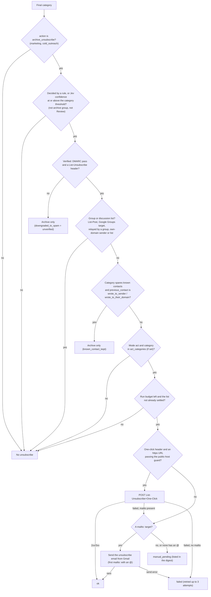

# How inbox-jev decides

This is the functional spec of the triage logic: what happens to one email, which signals are
checked, and why. Everything here describes the code on `main` (`src/inbox_jev/`) and the shipped
[`categories.yaml`](../categories.yaml). Numbers are the shipped defaults; where a setting can
change them, the setting is named.

- The design decisions behind these rules, with the alternatives that were rejected, are in
  [`docs/decisions/`](decisions/README.md).
- Every worked example below (`EX-NN`) has a test with the same ID in
  [`tests/test_spec_examples.py`](../tests/test_spec_examples.py) that runs the real code. A test
  fails if an ID exists on only one side.
- **Changing decision logic?** Update this document, the matching examples and tests, and add an
  ADR when it is a design decision, in the same PR (see [CLAUDE.md](../CLAUDE.md)).

Contents:

1. [The pass over an inbox](#1-the-pass-over-an-inbox)
2. [The per-email pipeline](#2-the-per-email-pipeline)
3. [Decision tables](#3-decision-tables)
4. [What it checks and how](#4-what-it-checks-and-how)
5. [Worked examples](#5-worked-examples)
6. [Glossary](#6-glossary)

## 1. The pass over an inbox

`inbox-jev run` (`triage.run_account`) handles one account:

1. The **mode** is `--mode`, else the account's `mode`, else `MODE` from `.env` (default
   `dry_run`). A `runs` row is stored before anything else, so every failure below ends up in
   `runs.error` (shown in the digest) and the run still gets its `finished_at`. An
   `act_categories` key that isn't in `categories.yaml` fails the account's run before anything
   is touched. So does a Gmail token that can't be refreshed, with one of three `runs.error`
   texts, depending on how google-auth reports the failure:
   - `invalid_grant` (token expired or revoked): run `inbox-jev auth add EMAIL`;
   - a failure google-auth marks retryable (a 5xx or `temporarily_unavailable` with a JSON
     error body): "temporary", it will retry next run;
   - any other refresh failure (e.g. a 5xx whose body isn't JSON, such as an HTML error page,
     which google-auth marks non-retryable): "not invalid_grant", it will retry next run, and
     run `inbox-jev auth add EMAIL` if it persists.

   In all three the run fails and the next one tries again, and the token endpoint's response
   is never stored (only the `invalid_grant` summary line is). A missing (or malformed)
   `TYPESAFE_API_KEY` also fails the run before Gmail is touched, with `runs.error`
   "TYPESAFE_API_KEY is not set: add it to .env; nothing was processed", even when every email
   would be decided by a rule ([ADR 0031](decisions/0031-run-needs-the-jev-key-accounts-isolated.md)).
   Commands that never ask Jev (`digest`, `rules`, `stats`, `restore`, `reprocess`,
   `retry-errors`, `unsubscribe-retry`, `labels`, `senders backfill`, `--version`) don't need it.
2. In `label` and `act`, the Jev labels are created in Gmail if missing.
3. In `label` and `act`, **corrections** are checked first (`corrections.check`, see
   [3.7](#37-corrections-user-edits-and-restore)).
4. Gmail lists inbox message ids with `newer_than:<LOOKBACK>` (default `2d`, `run --lookback`
   overrides it), at most `MAX_MESSAGES_PER_RUN` (default 200, `run --limit` overrides it).
5. A listed email is **skipped** when its stored row is `restored`, or is `done` in the current
   mode or a stronger one. So an email seen in `dry_run` is processed again by `label` or `act`,
   and one seen in `label` is processed again by `act`. Rows with `status = error` are retried
   while they are still listed, with a backoff: after the n-th failure the email waits
   5 × 2n−1 minutes (5, 10, 20 … 320). After **8** failures (`db.MAX_ERROR_ATTEMPTS`,
   about 10.5 hours after the first) it is no longer retried: it stays in the inbox untouched,
   with `status = error`, and the digest lists it (see [EX-13](#ex-13--an-email-that-keeps-failing)).
   A success resets the count. `inbox-jev retry-errors -a EMAIL` resets it for every `error` row
   of the account, so the next run retries those still inside its `--lookback`.
6. Each remaining email goes through the [pipeline](#2-the-per-email-pipeline). An exception
   rolls back that email, stores it as `status = error` (counting one failure) and the run
   continues. A Gmail token refresh that fails mid-run (permanent or transient) is the
   exception: it fails the whole run instead and isn't counted against the email.
   A failed Jev call (after the SDK's own retries of timeouts, connection errors, 408, 429 and
   5xx) is sorted by `classifier.failure_kind`
   ([ADR 0030](decisions/0030-stop-asking-jev-when-it-is-down.md)):
   - **config** (401, 403, 404: key revoked, no access, unknown model): every call would fail
     the same way. The pass stops asking Jev at once, and the email that hit it is left as it
     was (not stored, no failure counted).
   - **rejected** (any other 4xx but 408 and 429, e.g. 400, 422): Jev refuses this email's
     request. The email is stored as `error` and gives up at once (`error_attempts` = 8), since
     retrying sends the same request; `retry-errors` makes the next run try it again
     ([EX-23](#ex-23--jev-refuses-one-email)).
   - **transient** (anything else): the email is stored as `error` with the usual backoff.

   After **3** failed Jev calls in a row (`triage.MAX_CONSECUTIVE_JEV_FAILURES`; flags-only calls
   count, a successful call resets the count) the pass also stops asking Jev. Once stopped, for
   the rest of the pass: an email that needs Jev's decision is left as it is (no sent-mail
   search, not stored, no failure counted) for the next run; an allowlisted email or one with a
   keep rule is decided without the flags, as when its flags-only call fails; other rule
   decisions go on as usual. The run then fails, logs `stopped asking Jev` and stores one of two
   `runs.error` texts: "Jev rejected the API key or model (…): check TYPESAFE_API_KEY and
   TYPESAFE_MODEL; …" or "Jev unavailable: 3 calls in a row failed (last: …); emails that need
   Jev wait for the next run" ([EX-21](#ex-21--jevs-api-key-is-revoked),
   [EX-22](#ex-22--jev-is-down-for-a-whole-pass)). `inbox-jev run` exits 1 when any account's
   run failed; the other accounts still run.

   A Jev error is stored (`messages.error`, `runs.error`) and logged as its type, HTTP status
   and request id only (`classifier.describe_jev_error`): the SDK's own message comes from the
   response body, which on a 400/422 can quote the request, i.e. the email. The only SDK texts
   kept are a connection error's (redacted, no response exists) and the SDK's own client-side
   messages from an allowlist (e.g. `Choice question "category" has no criteria…`), which name a
   question at most. A failed call is handled outside the `except` that caught it, so an error
   raised while handling it (e.g. a locked database) never carries it in its traceback. The
   `typesafe_sdk` logger is never set below INFO, since its DEBUG lines are the raw requests.
7. One unsubscribe budget is shared by the whole run: `MAX_UNSUBSCRIBES_PER_RUN` (default 20)
   attempts.

## 2. The per-email pipeline

`triage.process`, one email at a time:

```mermaid
flowchart TD
    A["Fetch the full message (gmail.get)<br/>headers, body (extract_body), snippet"] --> B["Signals from headers (signals.extract)<br/>then resolve_relay with group_domains"]
    B --> C{"Row seen in an earlier label/act pass<br/>and mode is not dry_run?"}
    C -- yes --> D{"Changed Jev category label<br/>or pulled back to INBOX?"}
    D -- yes --> D2["Record correction<br/>(sender rule, source correction)"]
    D -- no --> E
    D2 --> E{"User edit?<br/>starred, our label removed,<br/>another Jev label added"}
    E -- yes --> STOP["Hands off: mark done, change nothing in Gmail"]
    E -- no --> F
    C -- no --> F["Look up sender rule: the first active one decides (exact address, then @domain);<br/>if its category was removed from categories.yaml, no rule (never the @domain one behind it)"]
    F --> G{"Allowlisted?<br/>author in allow_senders/allow_domains,<br/>or group address in allow_senders"}
    G -- yes --> FL["Ask Jev for the flags only<br/>(Needs Reply, tags; no previous_contact);<br/>if the call fails, decide without them (warning)"]
    G -- no --> H{"Active sender rule?"}
    H -- no --> I["previous_contact (sent-mail search)<br/>then ask Jev (build_state);<br/>once the pass stopped asking Jev: left for the next run"]
    H -- yes --> HK{"Rule to a keep category?"}
    HK -- yes --> FL
    HK -- no --> J{"Rule would unsubscribe<br/>a category that spares known contacts?"}
    J -- yes --> K["previous_contact (sent-mail search)"]
    J -- no --> DEC
    I --> DEC
    K --> DEC
    FL --> DEC
    DEC["policy.decide<br/>allowlist / rule / threshold / archive group / Review<br/>+ Needs Reply and tag labels"] --> PL["policy.plan<br/>mode + act_categories"]
    PL --> AP["Gmail modify: add labels, remove INBOX (archive/spam),<br/>add SPAM, drop stale labels from an earlier pass"]
    AP --> DB["Store the row (category, confidence, probabilities, labels...)"]
    DB --> AR{"Jev decided (not allowlist or rule)<br/>and mode is not dry_run?"}
    AR -- yes --> AR2["rules.record_auto<br/>(count toward / reset an auto rule)"]
    AR -- no --> U
    AR2 --> U{"plan.unsubscribe and run budget left?"}
    U -- yes --> U2["Unsubscribe once per list<br/>(see the unsubscribe flow)"]
    U -- no --> LOG
    U2 --> LOG["Commit and log 'message processed'<br/>(incl. previous_contact, archive_group,<br/>timings_ms per stage)"]
```

The unsubscribe decision, across `policy.decide`, `policy.unsubscribe_gate`, `policy.plan`
(`policy.acts_on`), `triage._unsubscribe` and `unsubscribe.unsubscribe`:

C, D and E are one pure function, `policy.unsubscribe_gate`, which every path that can unsubscribe
calls: the Jev path and the rule path of `run` (through `policy._check_unsubscribe`, only on a
decision that would otherwise unsubscribe), the rule path's sent-mail search
(`triage.rule_needs_contact`) and `unsubscribe-retry`. It also refuses a category that doesn't
unsubscribe and an allowlisted sender (on `run` the allowlist has already decided `important`).
F is `policy.acts_on`, the one mode / `act_categories` check, used by `policy.plan`,
`triage.rule_needs_contact` and `unsubscribe-retry`. The list's state (G) is I/O and stays in
`triage` ([ADR 0026](decisions/0026-one-unsubscribe-gate-for-every-path.md)).

The gate reports the first check that refused (`Veto`), and `_check_unsubscribe` sets a flag only
for that one. So `downgraded_to_spam` means "an unsubscribe was skipped because the sender is
unverified" and `known_contact_kept` means "an unsubscribe was skipped because of a known
contact": an unverified or group sender never gets `known_contact_kept`, and an archive-group or
Review decision never gets `downgraded_to_spam`
([ADR 0023](decisions/0023-one-order-for-unsubscribe-checks.md)).

## 3. Decision tables

### 3.1 Categories

From `categories.yaml`. An account can raise or lower any threshold with `min_confidence:
{category: value}` in `accounts.yaml`.

| Category | Label | `action` | `min_confidence` | Notes |
|---|---|---|---|---|
| `important` | `Jev/Important` | keep | 0.0 | Allowlist target. Also the fallback for an answer naming an unknown category. |
| `action_required` | `Jev/Action` | keep | 0.0 | Own digest section. Includes a held message pending your approval. |
| `transactional` | `Jev/Transactional` | archive | 0.80 | |
| `notification` | `Jev/Notifications` | archive | 0.80 | Includes groups' held-spam reports. |
| `newsletter` | `Jev/Newsletters` | archive | 0.80 | |
| `marketing` | `Jev/Marketing` | archive_unsubscribe | 0.90 | `unsubscribe_known_contacts: true` (default). |
| `cold_outreach` | `Jev/Outreach` | archive_unsubscribe | 0.90 | `unsubscribe_known_contacts: false`. |
| `spam` | `Jev/Spam` | spam | 0.90 | Fraud only: scams, phishing, forged authentication. |

Extra labels:

| Label | When |
|---|---|
| `Jev/Needs Reply` | Jev's `needs_reply` ≥ 0.7 (`needs_reply.threshold`) **and** the decision doesn't archive or spam the email. Also on allowlist decisions and rules to a keep category, where Jev is asked for the flags only ([3.5](#35-sender-rules)). Never on rules to archive or spam categories (Jev isn't asked). |
| `Jev/Invoices` | Tag `invoice_to_pay` ≥ 0.8. Added whatever the category, archived or not. Also on allowlist and keep-rule decisions; never on rules to archive or spam categories. |
| `Jev/Review` | The decision is low confidence (below the threshold and no archive group), or Jev named a category that doesn't exist. |
| `Jev/Processed` | Every email labeled in `label` or `act` mode. |

With the shipped thresholds (0.0), a keep answer is always applied and never goes to Review.

### 3.2 Confidence outcomes (Jev path)

`threshold` = the account's `min_confidence` for the category, else the category's own.

| Situation | Outcome | Unsubscribe | Spam |
|---|---|---|---|
| Jev's category isn't in `categories.yaml` | `important`, confidence 0.0, `Jev/Review` (low confidence) | no | no |
| `confidence ≥ threshold` | The category's action: keep, archive, archive + unsubscribe checks, or spam | only after the [unsubscribe checks](#33-unsubscribe-conditions) | `spam` category only |
| Below threshold and the **archive group** holds (next table) | Archived under the top category, `archive_group = true`, no Review | **never** | **never** |
| Otherwise | Stays in the inbox with `Jev/Review` + the suggested category label (`low_confidence = true`) | no | no |

**Archive group** (`policy._archive_group_confident`). All of these must hold:

| # | Condition | Shipped value |
|---|---|---|
| 1 | `archive_group_min_confidence` is set (remove it to disable the group) | 0.90 |
| 2 | Jev's top category has action `archive` or `archive_unsubscribe` (spam and keep categories never use the group) | |
| 3 | Needs-reply veto doesn't apply. It applies when `needs_reply ≥ 0.7` **and** either `previous_contact` is `wrote_to_sender` / `wrote_to_their_domain` and the email can be replied to (not [`no_reply`](#48-machine-and-no-reply-addresses)), or the keep categories (`important` + `action_required`) together reach `archive_group_reply_keep_probability` | 0.05 |
| 4 | Floor = max(`archive_group_min_confidence`, the top category's `threshold`): the group never lowers a bar | 0.90 |
| 5 | The probabilities of the counted categories add up to the floor or more. A category counts when its action is `archive`/`archive_unsubscribe`, it is in `act_categories` (when the account sets it), and it is the top category or its threshold (the account's `min_confidence`, else the category's own) is at most the floor | 0.80 / 0.90 ≤ 0.90: every archive category counts |

`archive_group_reply_keep_probability` must be at most `1 - archive_group_min_confidence`
(config load fails otherwise): the group only fires when the archive categories hold ≥ 0.90, so
the keep categories hold ≤ 0.10 and a higher value could never be reached. `0` means any reply
signal blocks the group.

When the veto applies, the email falls through to Review, and since it isn't archived it also
gets `Jev/Needs Reply`.

For a **no-reply** email (the sender is a no-reply address and so is every `Reply-To`, see
[4.8](#48-machine-and-no-reply-addresses)) the known contact doesn't count: nobody reads a reply,
so the reply signal is judged as for a stranger, by the keep categories alone. Jev's question
asks for "a reply or an action", so the keep-signal half of the veto still applies, and a kept
no-reply email still gets `Jev/Needs Reply` (the action may be real)
([EX-25](#ex-25--a-no-reply-sender-from-a-domain-you-write-to),
[ADR 0032](decisions/0032-machine-addresses-make-no-known-contact.md)).

### 3.3 Unsubscribe conditions

An unsubscribe is irreversible. During `run` it happens only when **all** of these hold:

| # | Condition | Where |
|---|---|---|
| 1 | The final category's action is `archive_unsubscribe` | `policy._apply` |
| 2 | Decided by a sender rule, or by Jev at or above the category threshold. An archive-group or Review decision never unsubscribes | `policy.decide` |
| 3 | **Verified**: `dmarc=pass` in Gmail's own `Authentication-Results` ([4.2](#42-dmarc)) and a `List-Unsubscribe` header with an `https:` or `mailto:` URI (an `http:`-only header counts as none, [4.3](#43-list-unsubscribe-one-click-and-mailto)). If not, the email keeps its category, is archived, and `downgraded_to_spam` is set ("unsubscribe skipped: unverified sender"). It is never moved to Spam for this | `policy.unsubscribe_gate` |
| 4 | **Not a group or discussion list** (`_group_list`): no `List-Post` header; no unsubscribe target on `googlegroups.com` / `groups.google.com` (host or subdomain); not relayed by a Google Group (`group_author` found, trusted or not); sender domain and `List-Id` not on the account's own domain (or a subdomain) | `policy.unsubscribe_gate` |
| 5 | For a category with `unsubscribe_known_contacts: false` (`cold_outreach`): `previous_contact` is not `wrote_to_sender` / `wrote_to_their_domain` (`known_contact_kept` otherwise). Unknown (`None`, the search failed or wasn't run) does **not** block it | `policy.unsubscribe_gate` |
| 6 | Mode is `act`, and the account has no `act_categories` or lists the category | `policy.acts_on`, from `policy.plan` |
| 7 | The run's budget (`MAX_UNSUBSCRIBES_PER_RUN`, 20) has attempts left | `triage.process` |
| 8 | The list isn't **settled**: no `unsubscribes` row for `(account, list_key)`, or its row is `failed` with fewer than 3 attempts | `triage._unsubscribe` |
| 9 | `dmarc_pass` again, inside the unsubscriber (defence in depth) | `unsubscribe.unsubscribe` |

The same checks run on the **rule path**, in the same order: a sender rule skips Jev, not the
sender checks. For a
rule to a category that spares known contacts, `triage` runs the sent-mail search only when the
answer could change the outcome (`triage.rule_needs_contact`: `acts_on`, `unsubscribe_gate`
passes with only the unknown contact left to decide, list not settled).

A `failed` row is retried by `run` the next time an email from the same list passes all the
checks (until 3 attempts), and by `inbox-jev unsubscribe-retry`. Both store an attempt the same
way (`triage.record_attempt`: result, `attempts + 1`, time, an `unsubscribe` log line).

**`unsubscribe-retry`** (`triage.retry_unsubscribes`) re-checks each `failed` row with fewer than
3 attempts against the email's current state, with the same `acts_on` and `unsubscribe_gate`
as `run`. Differences from `run`:

| Check | `run` | `unsubscribe-retry` |
|---|---|---|
| Mode not `act` | No unsubscribe | Every row held: `held: mode is …` |
| Stored message missing | n/a | held |
| Row restored or `corrected_category` set | Restored: never processed again. Corrected: the correction rule decides | `skipped` (before any Gmail call) |
| Run cap | 20 per run | 20 per call; extra rows held |
| Email deleted (404) | n/a | held; any other Gmail error is raised |
| `SPAM` or `TRASH` label in Gmail | n/a | `skipped` |
| Correction visible in live labels, or a user edit (starred, our label removed, another Jev label added) | Correction learned / hands off | `skipped` |
| Category | Current rule, else Jev | Current rule (if its category exists), else the stored category |
| Current rule points to a non-unsubscribing category | Rule decides | `skipped` |
| Stored category from a rule that was since deleted | Jev is asked again | held: `rule since removed` |
| Stored Jev category | Jev's fresh answer vs threshold | Stored confidence must still be ≥ the current threshold (account override included) and not `low_confidence`; else held |
| Category not unsubscribing or not in `act_categories` | No unsubscribe | held |
| Allowlisted sender | No Jev, `important` | `skipped` |
| Unverified, group or own list | No unsubscribe | `skipped` |
| Known contact (`cold_outreach`) | No unsubscribe | `skipped` |
| Sent-mail search fails (`None`) | **Unsubscribe goes ahead** | **held**: nothing in a manual retry is urgent |

`skipped` rows get `error = "retry: <reason>"` and are settled, so `run` won't retry them either.
Held rows stay `failed`.

### 3.4 Groups and mailing lists

| Case | Sender used for rules, allowlist, `previous_contact`, DB, digest | Jev state | Unsubscribe |
|---|---|---|---|
| Direct mail | `From` address | `from` header | Per [3.3](#33-unsubscribe-conditions) |
| Google Group on a domain in the account's `group_domains`, with the [trust checks](#45-x-original-sender-trust) passing | The author (`X-Original-Sender`); `relayed_by` = group address | adds `original_sender` and `sent_via_group` | **Never** |
| Google Group on any other domain (incl. `@googlegroups.com`, public providers), or trust checks failing | The group address (`From`) | `from` header only | **Never** if `X-Original-Sender` was a candidate, a `List-Post` is present, the target is Google Groups, or the group is on your own domain; else per 3.3 |
| Mail the group itself sends (held-spam report, moderation notice): no `X-Original-Sender` | The group address | `from` header | Per 3.3; never for a group on your own domain |
| Other discussion lists (Mailman, groups.io, LISTSERV, Discourse) | `From` (the list) | `from` header | **Never** (`List-Post`) |
| ESP / sequence tool (Mailchimp, Instantly…) | `From` | `from` header | Per 3.3 (they don't send `List-Post`) |

- `group_domains` is opt-in and empty by default, not even the account's own domain. Entries are
  normalised (lowercase, no trailing dot, no leading `@`) and rejected when they aren't a domain,
  are a bare public suffix like `co.uk` / `com.ar`, or are (or end in) a public mail provider,
  `googlegroups.com` or `groups.google.com`.
- **Allowlist**: `allow_senders` / `allow_domains` are matched against the resolved sender. For a
  trusted group that is the author, so `allow_domains: [yourco.com]` does **not** trust strangers
  writing to `hello@yourco.com`; put the group's exact address in `allow_senders` to allowlist
  it. For an untrusted group the sender is the group address, so an `allow_domains` entry for the
  group's domain allowlists everything sent through it.
- Rules and corrections for a trusted group key on the author; untrusted groups stay keyed on the
  group address, never on the author they claim.
- `list_key` (once per list) is `List-Id`, else the sender domain.

### 3.5 Sender rules

| Rule source | Created by | Key | Overrides |
|---|---|---|---|
| `manual` | `inbox-jev rules set -a EMAIL SENDER CATEGORY` | address or `@domain` | Replaces any rule on the same key (`rules.set_rule`), including correction and auto rules |
| `correction` | A detected correction ([3.7](#37-corrections-user-edits-and-restore)) | exact resolved sender address | Replaces any rule on the same key |
| `auto` | `rules.record_auto` after consistent Jev answers | exact resolved sender address | Never changes manual/correction rules |

- Lookup (`rules.match`): the first active rule decides, on the exact address, else on `@domain`
  (`policy.rule_keys`). Allowlist wins over rules.
- A rule decision has source `rule` and confidence 1.0, and no `previous_contact` unless the
  unsubscribe needs it.
- **Rules to a keep category** (`important`, `action_required`), like the allowlist, still ask
  Jev, for the flags only: `Jev/Needs Reply` and the tag labels follow Jev's answer, the
  category stays the rule's (or `important`), Jev's own category is stored as `jev_category`
  and ignored, and the answer never counts toward an auto rule. No sent-mail search is run for
  it (`previous_contact` is left out of the Jev state). If that call fails (a Jev outage, an
  error on that email), the email is decided without Jev's answer, as if it hadn't been asked:
  labeled by the rule or the allowlist, without Needs Reply or tags, with a warning in the log
  (`flags-only Jev call failed`, account, id, error type, status and request id; no content).
  It isn't stored as `error`. Once the pass has stopped asking Jev ([§1](#1-the-pass-over-an-inbox)),
  such an email is decided the same way without a call. See
  [EX-19](#ex-19--jev-is-down-when-an-allowlisted-email-arrives).
  **Rules to an archive or spam category**
  skip Jev: their email leaves the inbox, where Needs Reply is never added. See
  [EX-15](#ex-15--a-client-with-a-keep-rule-asks-a-question) and
  [ADR 0020](decisions/0020-flags-for-allowlist-and-keep-rules.md).
- A rule whose category no longer exists in `categories.yaml` counts as no rule: when it is the
  first match, Jev decides. Lookup **never falls through** to the `@domain` rule behind a stale
  exact rule: the exact rule is your exception to the domain rule, so applying the domain rule
  would undo it (archive, maybe unsubscribe, the sender you singled out). A stale `@domain` rule
  with no exact rule also sends the email to Jev. It is logged once per run
  (`sender rule ignored: unknown category`) and left in the DB, active, for you to
  `rules delete` (or to apply again if the category comes back). `unsubscribe-retry` and
  `dry_classify.py` use the same lookup. An **auto** rule in that state is relearned like a
  pending one: auto rules are keyed on the exact address, so a stale one is always the first
  match and its sender goes to Jev; the next counted answer replaces its category with
  `hits = 1`. See [EX-14](#ex-14--a-rule-to-a-category-you-removed).

**Automatic rules** (`rules.record_auto`): only decisions Jev made (source `jev`, not allowlist
or rule, so never a flags-only answer), and only in `label` and `act`. Nothing is learned in
`dry_run` ([EX-18](#ex-18--a-dry-run-trial-learns-no-rules)):

| Step | Condition | Effect |
|---|---|---|
| Reset | The decision is a keep category, **or** the keep categories other than the decided one hold ≥ `auto_rule.max_keep_probability` (0.02) — even on a low-confidence answer — **and** the sender has a pending (inactive) `auto` rule to a non-keep category | `hits = 0` |
| Doesn't count | `low_confidence`, `archive_group`, a known contact (`previous_contact` is `wrote_to_sender` / `wrote_to_their_domain`) in a category that spares known contacts, the keep signal above, or Jev's confidence < `auto_rule.min_confidence` (0.95) | nothing more |
| Counts, no rule yet | | new `auto` rule, `hits = 1`, active if `auto_rule.hits` ≤ 1 |
| Counts, rule is manual/correction, or an active auto rule to an existing category | | unchanged |
| Counts, same category | | `hits += 1`; active at `auto_rule.hits` (3) |
| Counts, other category (incl. an active auto rule to a removed category) | | category switches, `hits = 1`, active only if `auto_rule.hits` ≤ 1 |

Unverified senders (`downgraded_to_spam`) can earn a rule: the rule path re-runs the
DMARC/`List-Unsubscribe`/group checks on each email. A known contact never earns a rule to a
category that spares known contacts (`cold_outreach`), whether the sender is verified, unverified
or a group: such a "pitch" is where Jev is most likely wrong, so the sender stays on the Jev path.
Keep categories can earn a rule too.

### 3.6 Modes and `act_categories`

`policy.plan`, with `policy.acts_on` deciding whether a category is acted on:

| Mode | DB + digest | Gmail labels | Archive / spam / unsubscribe |
|---|---|---|---|
| `dry_run` | yes (no auto rules learned) | no | no |
| `label` | yes | yes (+ `Jev/Processed`) | no |
| `act` | yes | yes | yes |
| `act`, category not in the account's `act_categories` | yes | yes | no (treated as `label`) |

- `act_categories` is matched against the **final** category. Absent = every category acts; `[]`
  = none; an empty key (`act_categories:` with nothing) is rejected at load.
- In `act`, archive removes `INBOX`; spam removes `INBOX` and adds `SPAM` (the row is `spammed`,
  not `archived`).
- When an email is processed again (weaker mode before, or `reprocess`), labels from the earlier
  pass that the new plan doesn't add are removed (never `SPAM`).
- `inbox-jev reprocess -a EMAIL --category KEY [--low-confidence-only]` sets act rows that are
  `done`, not archived, spammed or restored, back to `label`, so the next `act` run (within its
  `--lookback`) redoes them.

### 3.7 Corrections, user edits and restore

**What counts as a correction** (`corrections.detect`, given the email's current labels):

| Current state in Gmail | Correction to |
|---|---|
| Exactly one Jev category label, different from the stored category | That category |
| Exactly one Jev category label, the stored one, the row was low confidence and `Jev/Review` was removed | The stored category ("accepted the suggestion") |
| Archived or spammed by us and back in `INBOX`, when neither row above applies | `important` |
| Two or more category labels, or none, and not pulled back | none |

A correction sets `corrected_category` on the row and a `correction` sender rule (active) on the
row's stored sender. It is checked in two places:

- `corrections.check`, at the start of every `label`/`act` run: rows that are `done`, not
  `dry_run`, not restored, not yet corrected, processed in the last **7 days**, and not checked
  in the last **hour**; never-checked rows first (newest first), then the ones checked longest
  ago, at most **100** per run, so older rows aren't starved when there are more. Deleted emails
  are skipped.
- In the pipeline, when an email from an earlier `label`/`act` pass is processed again.

**User edits = hands off** (`triage._user_edit`, only for rows that have labels from an earlier
pass, and never in `dry_run`):

| Edit | Result |
|---|---|
| Email is starred | Hands off, **even after a correction** |
| Row has a correction | Processed again: the new correction rule decides |
| A label we added (other than `Jev/Processed`) was removed | Hands off |
| A Jev label we didn't add (category, `Jev/Needs Reply`, `Jev/Review`, tag) is present | Hands off |

"Hands off" means: the row is marked `done` in the current mode, nothing changes in Gmail and the
email isn't revisited in that mode. A starred **new** email (no earlier pass) is processed normally.

**Restore** (`inbox-jev restore -a EMAIL --since 1d [--category K]`, `triage.restore`): for
`label`/`act` rows in the window, moves archived/spammed emails back to the inbox, removes our labels and `SPAM`, and marks
them `restored`. Restored emails are never processed again, aren't learned as corrections, and
their failed unsubscribes are `skipped` by `unsubscribe-retry`. Unsubscribes can't be undone.
An email Gmail no longer has (HTTP 404) is skipped, its row left unchanged, and counted in the
command's output; any other Gmail error stops the command (emails restored before it stay
restored). See [EX-20](#ex-20--restore-with-an-email-deleted-in-gmail).

## 4. What it checks and how

### 4.1 `previous_contact`

`triage.previous_contact(gmail, account, sender)` returns `wrote_to_sender`,
`wrote_to_their_domain`, `never`, or `None` (unknown):

1. The sender (resolved: a trusted group's author) is lowercased and must match
   `^[a-z0-9._%+-]+@[a-z0-9.-]+\.[a-z]{2,}$`. Otherwise `None` with no query (odd characters would
   change the search).
2. Unless the sender is a [machine address](#48-machine-and-no-reply-addresses) (writing to
   `noreply@` or a bounce address doesn't make anyone a contact, so it isn't searched): Gmail
   search `in:sent to:<sender>` (`maxResults=1`). A hit → `wrote_to_sender`.
3. Unless the sender's domain is a free-mail provider (`gmail.com`, `googlemail.com`,
   `outlook.com`, `hotmail.com`, `live.com`, `msn.com`, `yahoo.com`, `icloud.com`, `me.com`,
   `aol.com`, `proton.me`, `protonmail.com`, `gmx.com`) or the account's own domain: search
   `in:sent to:<domain>` (`maxResults=25`, `gmail.SENT_DOMAIN_SAMPLE`), then read the `To`, `Cc`
   and `Bcc` headers (`format=metadata`, no body) of the matches, newest first, one at a time.
   The first email with a recipient on the domain (or a subdomain) that isn't a machine address
   → `wrote_to_their_domain` (`signals.wrote_to_person_at`). An email with no recipient on the
   domain at all (Gmail's `to:` matched something the headers don't show) also counts, as
   before. When all 25 went only to machine addresses and Gmail has more, it counts too (an
   older one might be to a person; logged as `sent-mail sample inconclusive`). An email deleted
   between the search and the read (404) is skipped. The `list` and each read retry a 429, 5xx or
   rate-limit 403 with backoff (googleapiclient, `gmail.SINGLE_RETRIES` = 3) before failing.
4. Otherwise `never`. So replies to LinkedIn notifications (`m-…@bounce.linkedin.com`) no
   longer make every LinkedIn email a known contact
   ([EX-24](#ex-24--replies-to-notifications-dont-make-a-contact)).

Each query's answer is cached in the `Gmail` object, so per account per run. Any exception →
`None` (logged as a warning, not cached).

**Cost** (Gmail quota units: `messages.list` and `messages.get` cost 5 each), per new sender and
run: the address search is one `list`. The domain search is one `list` plus one metadata `get`
per match read, stopping at the first person: usually one read for a real contact's domain, and
at most 25 (130 units) for a domain written to only at machine addresses.

When it runs: on the Jev path for every email (in every mode, including `dry_run`), and on the
rule path only when `triage.rule_needs_contact` says it can change an unsubscribe. Never for
allowlisted senders or keep rules (their flags-only Jev call goes without it).

Consequences of each value:

| Value | Jev state | Needs-reply veto on the archive group | `cold_outreach` unsubscribe (`run`) | `unsubscribe-retry` | Auto rule |
|---|---|---|---|---|---|
| `wrote_to_sender` / `wrote_to_their_domain` | sent | any reply signal vetoes (a no-reply email: only with keep probability ≥ 0.05) | no (`known_contact_kept` when verified and not a group) | `skipped` | doesn't count in a category that spares known contacts, verified or not, group or not |
| `never` | sent | only with keep probability ≥ 0.05 | yes | proceeds | normal |
| `None` | key left out | only with keep probability ≥ 0.05 | **yes** (other checks still apply) | **held** | normal |

The value is logged on the "message processed" line; it isn't stored in the DB.

### 4.2 DMARC

`signals.dmarc_passed(Authentication-Results headers)`: Gmail prepends its own
`Authentication-Results`, and a sender can inject more (even ones claiming `mx.google.com`).
Only the **topmost** header that starts with `mx.google.com` is trusted. Every `dmarc=` verdict in
it must be `pass`, and there must be at least one. If no header starts with `mx.google.com`, DMARC
doesn't pass: Gmail stamps every inbound email, so any other header could be the sender's own
([EX-17](#ex-17--an-unsubscribe-header-without-gmails-authentication-results)). Besides the
unsubscribe checks, `dmarc_pass` also gates the Google Groups author recovery ([4.5](#45-x-original-sender-trust)).

### 4.3 `List-Unsubscribe`, one-click and `mailto:`

- `List-Unsubscribe` (first header) is parsed as RFC 2369 `<uri>` entries. Only `https://` and
  `mailto:` URIs are kept; `http://` and anything else is ignored. "Has unsubscribe" = at least
  one of them. So an `http://`-only header counts as no header: the sender is unverified
  (archived only, `downgraded_to_spam`), the URL is never `POST`ed nor offered as a
  `manual_pending` link, and `is_mailing_list` in the Jev state depends on `List-Id` alone
  ([ADR 0025](decisions/0025-http-only-list-unsubscribe-is-none.md)).
- **One-click** = `List-Unsubscribe-Post` contains `List-Unsubscribe=One-Click` (spaces and case
  ignored) and there is at least one `https` URI.
- Order in `unsubscribe.unsubscribe`:
  1. `dmarc_pass` is false → `manual`/`skipped` (never reached from `run`, which checks first).
  2. With one-click: the first `https` URL that passes the guard gets a `POST` with form body
     `List-Unsubscribe=One-Click`, 15 s timeout, **no redirects**. A 2xx or 3xx is `ok`. If it
     fails and a `mailto:` exists, go to step 3; if it fails and none exists, `failed`. URLs that
     fail the guard are skipped.
  3. The first `mailto:` with an `@` gets an email from your Gmail (subject and body from the
     URI, default `unsubscribe`). Sent → `ok`; error → `failed`.
  4. Otherwise `manual_pending` with the first `https` URL as target (listed in the digest).
- **URL guard** (`resolve_public_https`): scheme `https`, a hostname, and every address it
  resolves to is global (no private, loopback or link-local IPs); a DNS failure rejects it. The
  `POST` then connects to the validated addresses itself, in DNS order, with the URL's hostname
  as `Host` and for TLS (SNI and certificate check), so a second DNS answer can't redirect it to
  an internal host (DNS rebinding). An address that can't be connected to (refused, connect
  timeout, TLS failure) is skipped for the next one; once a request was sent, its answer is the
  result. The client ignores proxy environment variables (`HTTPS_PROXY`).
- Links in the body are never followed.

### 4.4 `List-Post`

Any non-empty `List-Post` header marks a discussion list (RFC 2369; set by Google Groups, Mailman,
groups.io, LISTSERV, Discourse; not by ESPs or sequence tools). Its `List-Unsubscribe` would
remove *you* from the list, so it is never used.

### 4.5 `X-Original-Sender` trust

`signals.original_sender` records a candidate author (`group_author`) only when:

- `dmarc=pass` for the message (so for the group's `From` domain);
- the first `Mailing-list` header starts with `list <address>` and that address equals the
  `From` address;
- `X-Original-Sender` is a valid address different from `From`.

`signals.resolve_relay` then moves the candidate into `sender` (and the group into `relayed_by`)
only when the `From` domain is one of the account's `group_domains` or a subdomain of one. Any
candidate, trusted or not, makes the email a group for the unsubscribe check.

### 4.6 Body extraction

`gmail.extract_body(payload)` walks the MIME tree:

- Parts with a filename (attachments) are skipped.
- Within each `multipart/alternative` that has a `text/plain` part, its plain text is used,
  **unless it is a stub**: plain text shorter than **300** characters (URLs removed before
  counting) next to HTML whose stripped text (URLs removed) is at least **3×** as long, with a
  minimum of 3 × 20 = **60** characters. An empty plain part always yields to its HTML. The check
  only compares an alternative's own plain and HTML versions, so a note you wrote above a
  forwarded HTML message is never dropped.
- At the top level, all text segments are joined. Only when there is no text at all are the
  remaining HTML parts (those not already resolved inside an alternative) stripped and used.
- HTML is stripped by dropping `<script>`, `<style>` and `<head>` content, joining text nodes with
  spaces and unescaping entities.
- Normalisation: runs of spaces, tabs, no-break spaces (U+00A0) and zero-width non-joiners
  (U+200C) become one space; trailing whitespace before a newline is removed; the result is
  stripped.

If the body is empty after all that, Jev gets Gmail's `snippet` (HTML-unescaped) instead.

### 4.7 What Jev receives

`classifier.build_state` sends:

| Key | Value |
|---|---|
| `recipient` | The account's address |
| `from`, `to`, `cc`, `subject` | First header value (raw; for a group, `from` shows the group) |
| `date` | Gmail's internal date, ISO 8601 UTC |
| `is_mailing_list` | `List-Id` present or a usable `List-Unsubscribe` (`https`/`mailto`) |
| `precedence` | `Precedence` header or null |
| `body` | Extracted body, else the snippet, first `BODY_CHARS` (3000) characters |
| `original_sender`, `sent_via_group` | Only for a trusted group relay: the author and the group |
| `previous_contact` | Only when known (`None` leaves the key out); always left out of the flags-only call for allowlist and keep-rule emails |

Questions (`build_questions`): one `Choice` over the categories, with each category's `criteria`
and the instruction to judge by who wrote it and why, explaining `previous_contact` ("a
personal-looking pitch from a sender I never wrote to is usually cold outreach"); one `Noul` for
`needs_reply`; one `Noul` per tag. The answer gives the category, its confidence, every
category's probability, `needs_reply` and the tag probabilities.

### 4.8 Machine and no-reply addresses

One set of pure helpers in `signals.py`, used by both guards. When unsure, an address is **not**
a machine: a false "machine" hides a real contact, which archives (and unsubscribes) more, the
dangerous direction ([ADR 0032](decisions/0032-machine-addresses-make-no-known-contact.md)).

| Helper | Yes | No (examples) |
|---|---|---|
| `is_no_reply_address` | Local part `noreply`, `no-reply`, `no_reply`, `donotreply`, `do-not-reply`, `do_not_reply`, alone or as one piece of a local part split on `.` `_` `+` `-` (`messages-noreply@`, `noreply-billing@`, `alerts.no-reply@`) | `norah@`, `noreplies@`, `reply@`, `notifications@`, `info@`, `jane@noreply.com` |
| `is_automated_address` | Any no-reply address; local part `bounce`/`bounces` alone, followed by `+` or `=`, or followed by `.` `_` `-` and a token with 3+ digits (`bounce-12345-67@`); `reply+<token>`; `reply-<token with 3+ digits>`; `mailer-daemon`, `postmaster`; a host with a `bounce`, `bounces` or `reply` label left of its registrable domain (`m-a175…@bounce.linkedin.com`, `reply+…@reply.github.com`, `x@bounce.linkedin.co.uk`) | `reply@company.com`, `reply-team@`, `reply-all2@`, `replies@`, `bouncer@`, `bounce.house@`, `bounce-rentals@`, `sam@reply.io`, `ana@reply.com.ar`, `jane@reply.co.uk`, `notifications@github.com` |
| `Signals.no_reply` | The (resolved) sender is a no-reply address **and** every `Reply-To` address is too (or there is none) | A `Reply-To` to anything else (a person, a help desk, a reply-by-email token) |

- **Registrable domain** (no public suffix list): the last two labels (`acme.com`, `reply.io`),
  or the last three when the TLD has two letters and the label before it has at most 4
  characters, so it can be a ccTLD's public suffix (`reply.com.ar`, `reply.co.uk`,
  `bounces.com.br`, `x.gob.ar`, `x.adv.br`, `x.gouv.fr`). Erring long only makes fewer machine
  hosts: a short name under a ccTLD (`bounce.sap.de`) isn't recognised, the safe side.
- `is_automated_address` is used by `previous_contact`: a machine sender isn't searched for itself,
  and the domain search ignores sent emails whose recipients on the domain are all machines. In
  the domain search the labels of the searched domain (the sender's) never count either, so a
  person at `reply.com.ar` counts for `reply.com.ar` whatever the suffix rule says.
- `no_reply` is used by the archive group's needs-reply veto ([3.2](#32-confidence-outcomes-jev-path)).
  `Jev/Needs Reply` itself is unchanged: Jev's question covers "a reply or an action", and a
  no-reply email can still ask for an action.

## 5. Worked examples

Addresses are fictional. The account is `me@example.com` with `group_domains: [example.com]`,
no allowlist unless stated, shipped `categories.yaml`, `MODE=act`, no `act_categories`. Only
the probabilities that matter are shown; the rest are ~0.

### EX-01 — Tool digest split between notification and newsletter

- **Test**: `test_ex01_tool_digest_split_is_archived_by_the_group`
- **Input**: weekly product-analytics digest from `digest@analytics.example`. Jev: notification
  0.55, newsletter 0.42, marketing 0.02, important 0.01; `needs_reply` 0.05.
- **Outcome**: archived as `notification` with `Jev/Notifications`; `archive_group = true`; no
  Review, no unsubscribe; doesn't count toward an auto rule.
- **Why**: notification alone (0.55) is below 0.80, but the archive categories add up to 0.99 ≥
  the floor max(0.90, 0.80). Jev is sure the email goes away, just not under which label. With
  `act_categories: [notification]`, only notification would count (0.55) and the email would go
  to Review.

### EX-02 — Automated payment approval

- **Test**: `test_ex02_payment_approval_stays_with_action_label`
- **Input**: `alerts@bank.example`, "Approve payment to Acme Supplies". Jev: action_required 0.93,
  transactional 0.05, important 0.02; `needs_reply` 0.85.
- **Outcome**: stays in the inbox with `Jev/Action` and `Jev/Needs Reply`; listed in the digest's
  `Jev/Action` section (and not repeated under "needs reply").
- **Why**: `action_required` is a keep category (threshold 0.0). Needs Reply is added because the
  email isn't archived. The answer doesn't count toward an auto rule (0.93 < 0.95, and important
  0.02 is a keep signal), so this sender keeps going through Jev.

### EX-03 — Bulk event newsletter with a "client doesn't support HTML" stub

- **Test**: `test_ex03_stub_plain_part_is_replaced_by_the_html`
- **Input**: `multipart/alternative` from an ESP: `text/plain` = "Your mail client does not
  support HTML messages. Copy and paste this URL into your browser:" plus a ~250-character
  tracking URL; `text/html` = the event's agenda and speakers. Jev (on the HTML text):
  newsletter 0.91, marketing 0.09.
- **Outcome**: Jev gets the HTML's text as `body`; archived as `newsletter` on its own confidence
  (not through the group).
- **Why**: the plain part is under 300 characters once the URL is removed, and its HTML sibling
  has more than 3× (and ≥ 60) characters of text. Before this rule Jev classified the stub blind
  (split cold_outreach / spam / marketing → Review). A short real reply next to similar HTML is
  kept as is.

### EX-04 — Cold-outreach sequence from a stranger, RFC 8058 headers

- **Test**: `test_ex04_stranger_sequence_is_archived_and_unsubscribed`
- **Input**: `sam@growthagency.example`, "Re: quick question about your pipeline". DMARC pass,
  `List-Unsubscribe: <https://unsub.sequencer.example/u/abc>, <mailto:unsub@growthagency.example>`,
  `List-Unsubscribe-Post: List-Unsubscribe=One-Click`, no `List-Post`. `previous_contact` =
  `never` (both searches empty). Jev: cold_outreach 0.96.
- **Outcome**: archived with `Jev/Outreach`; one-click `POST` to the https URL; `unsubscribes` row
  `one_click` / `ok`; the `mailto:` isn't used.
- **Why**: cold_outreach ≥ 0.90, verified sender, not a group, a stranger, act mode, budget left,
  list not settled. Sequence tools stop the sequence on unsubscribe.

### EX-05 — The same sequence from someone you wrote to

- **Test**: `test_ex05_known_contact_sequence_is_archived_only`
- **Input**: as EX-04, but your sent mail has an email to `sam@growthagency.example`
  (`previous_contact` = `wrote_to_sender`; `wrote_to_their_domain` behaves the same).
- **Outcome**: archived with `Jev/Outreach`; **no** unsubscribe (`known_contact_kept`); the answer
  doesn't count toward an auto rule.
- **Why**: `cold_outreach` has `unsubscribe_known_contacts: false`. A "pitch" from a known contact
  is where Jev is most likely wrong, and an opt-out can cover all of that company's mail. Keeping
  the sender on the Jev path means the relationship is seen on every email.

### EX-06 — A pitch relayed by your own Google Group

- **Test**: `test_ex06_pitch_via_own_group_uses_author_and_never_unsubscribes`
- **Input**: `From: "'Dana' via Hello" <hello@example.com>`, `X-Original-Sender:
  dana@pitchco.example`, `Mailing-list: list hello@example.com; contact
  hello+owners@example.com`, `List-Id: <hello.example.com>`, `List-Post:
  <mailto:hello@example.com>`, `List-Unsubscribe:
  <mailto:googlegroups-manage+1+unsubscribe@googlegroups.com>`, DMARC pass. The account also has
  `allow_domains: [example.com]`. Jev: cold_outreach 0.97.
- **Outcome**: sender = `dana@pitchco.example` (Jev gets `original_sender` and `sent_via_group`;
  `previous_contact` searches for Dana; the DB, digest and any auto rule use Dana). Archived with
  `Jev/Outreach`; **never** unsubscribed.
- **Why**: `example.com` is in `group_domains` and the trust checks pass, so the author is
  recovered. `allow_domains` matches the author, not the group, so the stranger isn't allowlisted.
  The `List-Unsubscribe` would remove *you* from `hello@`: relayed mail, `List-Post`, a Google
  Groups target and an own-domain list are each enough to block it.

### EX-07 — Google Groups held-spam report

- **Test**: `test_ex07_held_spam_report_is_archived_as_notification`
- **Input**: the group's "Moderator's spam report" for `hello@example.com`, sent by the group
  itself (no `X-Original-Sender`). Jev: notification 0.90, action_required 0.06.
- **Outcome**: archived with `Jev/Notifications` (an `archive` category: no unsubscribe).
- **Why**: the `notification` criteria include automated held-spam reports and `action_required`
  excludes them. A sender rule would be the wrong fix: the sender is the group, which also
  carries real mail. (If `allow_domains` covered `example.com`, the group address itself would be
  allowlisted and the report would stay as `important`.)

### EX-08 — Google Groups pending-approval notice

- **Test**: `test_ex08_pending_approval_notice_stays_actionable`
- **Input**: "A message to hello@example.com is pending your approval", sent by the group. Jev:
  action_required 0.96, notification 0.03; `needs_reply` 0.75.
- **Outcome**: stays in the inbox with `Jev/Action` and `Jev/Needs Reply`.
- **Why**: `action_required` explicitly covers a held message pending your approval: it is the
  only way a non-member (a prospect writing to `hello@`) gets delivered.

### EX-09 — Mass "free consultation" pitch that "expects a reply"

- **Test**: `test_ex09_mass_pitch_expecting_reply_is_group_archived`
- **Input**: "Get Your Free Consultation Today!" from a bulk sender, `previous_contact` = `never`.
  Jev: cold_outreach 0.67, marketing 0.31, important 0.00, action_required 0.00; `needs_reply`
  0.79.
- **Outcome**: archived as `cold_outreach` through the archive group; no Review, no
  `Jev/Needs Reply`, no unsubscribe.
- **Why**: archive categories sum to 0.98 ≥ 0.90. `needs_reply` ≥ 0.7, but the sender is not a
  known contact and the keep categories (0.00) are below 0.05, so the veto doesn't apply: every
  pitch "expects a reply". The group never unsubscribes (0.67 < 0.90).

### EX-10 — A known vendor's sales follow-up that expects a reply

- **Test**: `test_ex10_known_vendor_follow_up_stays_in_review`
- **Input**: same answer as EX-09 (cold_outreach 0.67, marketing 0.31; `needs_reply` 0.79), but
  from `rep@vendor.example`, a domain you have written to (`previous_contact` =
  `wrote_to_their_domain`).
- **Outcome**: stays in the inbox with `Jev/Review`, `Jev/Outreach` and `Jev/Needs Reply`.
- **Why**: for a known contact any reply signal vetoes the archive group, and cold_outreach alone
  is below 0.90. The same holds for a stranger when important + action_required reach 0.05.

### EX-11 — Cold outreach that can't prove who it is

- **Test**: `test_ex11_unverified_cold_outreach_is_archived_never_unsubscribed`
- **Input**: `founder@devshop.example`, no `List-Unsubscribe` (or DMARC not `pass`). Jev:
  cold_outreach 0.97.
- **Outcome**: archived with `Jev/Outreach`, `downgraded_to_spam = true`; never unsubscribed and
  never moved to Spam. It still counts toward an auto rule, because `previous_contact` is
  `never`. From a known contact it would be archived the same way, with `known_contact_kept =
  false` (the unverified check is what stopped the unsubscribe), and it wouldn't count toward an
  auto rule. A `List-Unsubscribe` with only an `http://` URL is treated like no header.
- **Why**: unsubscribing from an unverified sender only confirms your address; being unverified
  isn't fraud. A rule for it is safe: the rule path re-runs the sender checks on every email.
  Known contacts stay on the Jev path whatever the headers say.

### EX-12 — A correction becomes a sender rule

- **Test**: `test_ex12_pulling_back_to_inbox_becomes_a_rule`
- **Input**: in act mode, `news@weekly.example` is archived as `newsletter` (0.97). You move it
  back to the inbox. A week later another email from that sender arrives.
- **Outcome**: the next run records a correction to `important` and an active `correction` rule
  for `news@weekly.example`. The new email is decided by the rule and stays in the inbox with
  `Jev/Important`; since `important` is a keep category, Jev is asked only for its flags
  (Needs Reply, tags) and its own category is ignored.
- **Why**: pulling an archived email back to the inbox is a correction to `important`; changing
  the category label would be a correction to that category.

### EX-13 — An email that keeps failing

- **Test**: `test_ex13_failing_email_backs_off_then_gives_up`
- **Input**: in act mode, every call to Jev for `billing@vendor.example`'s "Invoice 7" fails.
  The timer runs every 10 minutes.
- **Outcome**: the first run stores the email as `error` (1 failure) and the run carries on with
  the other emails. A run less than 5 minutes later doesn't retry it; later runs retry it 5, 10,
  20, 40, 80, 160 and 320 minutes after each failure. After the 8th failure it is never retried
  again: it stays in the inbox with no Jev labels, and that day's digest lists it under "Sin más
  reintentos". If Jev answers on a retry before that, the email is processed normally and its
  failure count goes back to 0. `inbox-jev retry-errors` makes the next run try it again.
- **Why**: retrying every 10 minutes for the whole `LOOKBACK` (up to 288 times in 2 days) costs
  Jev calls and log noise for an email that fails the same way; the backoff still rides out an
  outage of several hours ([ADR 0017](decisions/0017-error-retry-backoff-and-cap.md)).

### EX-14 — A rule to a category you removed

- **Test**: `test_ex14_rule_to_removed_category_goes_through_jev`
- **Input**: a manual rule `@deals.example` → `promotions`, a category since removed from
  `categories.yaml`. Two emails from `sale@deals.example` arrive in one run. Jev: newsletter
  0.93, marketing 0.07. Also `@vendor.example` → `marketing` (manual) with the exception
  `billing@vendor.example` → `promotions` (manual, same removed category); `billing@` sends
  "Invoice 88". Jev: important 0.96.
- **Outcome**: the two `sale@` emails go through Jev and are archived as `newsletter`. "Invoice
  88" goes through Jev too and stays in the inbox as `important`: the `@vendor.example` rule
  doesn't apply. The run logs `sender rule ignored: unknown category` once for
  `@deals.example` and once for `billing@vendor.example`. The rules stay in the DB, active.
- **Why**: before, `decide` raised and the emails were stored as `error`, retried with the
  backoff until they gave up. Treating the rule as absent decides them the way they would be
  without it; leaving it in place keeps a manual or correction rule you may still want if the
  category comes back. Falling through to `@vendor.example` would apply the very rule the
  exact one overrode, without Jev, in `act`
  ([ADR 0019](decisions/0019-rules-to-removed-categories-ignored.md)).

### EX-15 — A client with a keep rule asks a question

- **Test**: `test_ex15_keep_rule_still_gets_needs_reply`
- **Input**: `ana@client.example` has a `correction` rule → `important`;
  `news@weekly.example` has an active `auto` rule → `newsletter`. Ana writes "Signed contract
  by Friday?". Jev: cold_outreach 0.55, important 0.45; `needs_reply` 0.92.
- **Outcome**: Ana's email stays in the inbox with `Jev/Important` and `Jev/Needs Reply`, and is
  listed in the digest's Needs reply section ("Piden respuesta" in `es`). Jev's cold_outreach
  answer is ignored (no `Jev/Outreach`), the answer counts toward no rule, and no sent-mail
  search runs. The newsletter is archived by its rule without a Jev call.
- **Why**: a keep rule (or the allowlist) is exactly the mail that needs a reply most, and its
  email stays in the inbox, so Needs Reply and the tags are worth one Jev call. An archive rule
  takes the email out of the inbox, where Needs Reply is never added, so it still skips Jev
  ([ADR 0020](decisions/0020-flags-for-allowlist-and-keep-rules.md)).

### EX-16 — The archive group respects a stricter category threshold

- **Test**: `test_ex16_archive_group_respects_category_thresholds`
- **Input**: `categories.yaml` raises `marketing`'s `min_confidence` to 0.95 (shipped: 0.90).
  `hello@brand.example` sends an announcement. Jev: newsletter 0.50, marketing 0.45,
  important 0.01.
- **Outcome**: stays in the inbox with `Jev/Review` and `Jev/Newsletters`. With
  `min_confidence: {marketing: 0.90}` on the account, marketing counts again and the email is
  archived as `newsletter` through the group.
- **Why**: a member whose threshold is above the floor (0.90) doesn't count, whether that
  threshold comes from the account or from the category; before, only the account's counted
  ([ADR 0021](decisions/0021-archive-group-member-threshold.md)). With the shipped thresholds
  (0.80 and 0.90) every archive category counts.

### EX-17 — An unsubscribe header without Gmail's Authentication-Results

- **Test**: `test_ex17_no_gmail_authentication_results_is_unverified`
- **Input**: `promo@shop.example` with `List-Unsubscribe: <https://shop.example/u/1>` and
  one-click, and a single `Authentication-Results: mail.shop.example; dmarc=pass …` (no
  `mx.google.com` header). Jev: marketing 0.97.
- **Outcome**: archived with `Jev/Marketing`, `downgraded_to_spam = true`; no one-click `POST`,
  no `unsubscribes` row.
- **Why**: Gmail stamps every inbound email with its own header; one that is missing means the
  only verdict was written by someone else, possibly the sender
  ([ADR 0022](decisions/0022-dmarc-only-from-gmail.md)).

### EX-18 — A dry-run trial learns no rules

- **Test**: `test_ex18_dry_run_learns_no_rules`
- **Input**: three issues from `news@weekly.example` in the inbox, each newsletter 0.97. A
  `dry_run` pass, then an `act` pass.
- **Outcome**: after `dry_run` there are no sender rules. The `act` pass asks Jev again for the
  three (dry-run rows are processed again), archives them, and only then the `auto` rule
  reaches 3 hits and activates.
- **Why**: a rule learned in `dry_run` would apply without Jev, and act, as soon as the mode
  changes, on answers nobody could correct (dry runs add no labels)
  ([ADR 0024](decisions/0024-no-auto-rules-in-dry-run.md)).

### EX-19 — Jev is down when an allowlisted email arrives

- **Test**: `test_ex19_flags_only_jev_failure_still_labels`
- **Input**: `acme.example` is on `allow_domains`, and `ana@client.example` has a `correction` rule
  → `important`. Each sends an email while every Jev call fails.
- **Outcome**: both are stored `done` (not `error`) with `Jev/Important`, without
  `Jev/Needs Reply` or tags, and stay in the inbox. The log has `flags-only Jev call failed`
  for each (account, id, error type; no subject or body). No error is counted for them.
- **Why**: the category was already decided by the allowlist or the rule; only the optional
  flags depend on Jev. Failing the email would make "always important" depend on Jev, and after
  8 failed passes it would never be labeled
  ([ADR 0020](decisions/0020-flags-for-allowlist-and-keep-rules.md)).

### EX-20 — Restore with an email deleted in Gmail

- **Test**: `test_ex20_restore_skips_emails_deleted_in_gmail`
- **Input**: in act mode, `news@weekly.example`'s issue (newsletter 0.97) and
  `promo@shop.example`'s sale (marketing 0.97) are archived. You delete the newsletter in Gmail,
  then run `inbox-jev restore -a me@example.com --since 1d`.
- **Outcome**: the sale goes back to the inbox without Jev labels and its row is `restored`. The
  deleted newsletter is skipped (Gmail answers 404), its row is left as it was, and the command
  says `Restored 1 emails. Skipped 1 deleted in Gmail.` Running it again restores nothing more and
  skips the newsletter again.
- **Why**: before, the first deleted email stopped the command with an error, and since its row
  was never marked restored, every later attempt stopped at the same email: nothing after it in
  the window could be undone. Skipping only 404s keeps any other Gmail failure visible
  ([ADR 0027](decisions/0027-restore-skips-deleted-emails.md)).

### EX-21 — Jev's API key is revoked

- **Test**: `test_ex21_revoked_jev_key_stops_jev_but_not_rules`
- **Input**: in act mode, Jev answers 401 to every call. The inbox has, in this order: a pitch
  from `sam@growthagency.example` (no rule), Lea's "Budget review" from the allowlisted
  `acme.example`, `news@weekly.example`'s issue (manual rule → newsletter) and Ana's "Signed
  contract by Friday?" (no rule).
- **Outcome**: Jev is called once, for Sam's pitch. The 401 stops the pass from asking Jev: Sam's
  and Ana's emails are left untouched in the inbox, not stored and not counted as failures. Lea's
  email still gets `Jev/Important` (no flags, no Jev call) and the newsletter is archived by its
  rule. The run fails with "Jev rejected the API key or model (TypeSafeAuthenticationError
  (HTTP 401)): check TYPESAFE_API_KEY and TYPESAFE_MODEL; …", `inbox-jev run` exits 1 and the
  digest lists the failed run. Once the key is fixed, the next run decides Sam's and Ana's
  emails as if nothing happened.
- **Why**: before, every email in the window was sent to Jev, failed and spent one of its 8
  attempts on a problem that wasn't the email's, and the run exited 0, every 10 minutes. Rules
  and the allowlist don't need Jev, so they keep working
  ([ADR 0030](decisions/0030-stop-asking-jev-when-it-is-down.md)).

### EX-22 — Jev is down for a whole pass

- **Test**: `test_ex22_jev_down_stops_after_three_failures`
- **Input**: in act mode, five emails with no rule arrive while every Jev call times out (after
  the SDK's own retries).
- **Outcome**: the first three are stored as `error` with one failure each (the usual backoff).
  After the third failure in a row the pass stops asking Jev: the other two aren't sent, stored
  or counted. The run fails with "Jev unavailable: 3 calls in a row failed (last:
  TypeSafeAPITimeoutError: …); emails that need Jev wait for the next run". When Jev is back,
  the next run decides the two that waited; the first three follow their backoff.
- **Why**: with Jev down, each email costs a call plus its retries (up to 30 s) and a failure;
  `MAX_MESSAGES_PER_RUN` of them per pass made each pass slow and burned attempts on emails
  that had nothing wrong with them. Three in a row tells an outage from one bad email
  ([ADR 0030](decisions/0030-stop-asking-jev-when-it-is-down.md)).

### EX-23 — Jev refuses one email

- **Test**: `test_ex23_jev_refuses_one_email`
- **Input**: in act mode, Jev answers 422 to `billing@vendor.example`'s "Invoice 7" (its error
  message quotes part of the email), and normally to the other email.
- **Outcome**: "Invoice 7" is stored as `error` with `TypeSafeUnprocessableEntityError (HTTP 422,
  request_id=…)`, never Jev's message, and gives up at once (8 failures): later runs don't send
  it again, and the digest lists it under "Sin más reintentos". The other email is processed and
  the run doesn't fail. `inbox-jev retry-errors` makes the next run try it again.
- **Why**: Jev would refuse the same request on every retry, so the backoff only adds calls; and
  its message can echo the email, which must never be stored or logged
  ([ADR 0030](decisions/0030-stop-asking-jev-when-it-is-down.md)).

### EX-24 — Replies to notifications don't make a contact

- **Test**: `test_ex24_replies_to_notifications_make_no_known_contact`
- **Input**: "Guillermo, you have 107 new lead suggestions" from
  `messages-noreply@social.example` (the real case was LinkedIn). Your sent mail has 12 emails
  from 2021 to `m-a175…@bounce.social.example` (replies to notifications), none to a person at
  `social.example`. Jev: notification 0.62, newsletter 0.36, important 0.01; `needs_reply` 0.75.
- **Outcome**: `previous_contact` = `never`: the sender isn't searched (a machine address), and
  the domain search reads the `To`/`Cc`/`Bcc` of the 12 matches and finds only machine
  addresses. The email is archived as `notification` through the archive group, without Review
  or `Jev/Needs Reply`. With one more sent email to `jane@social.example` it would be
  `wrote_to_their_domain` again (one read: the newest match).
- **Why**: before, any sent email matching `to:social.example` made every email from that
  domain a known contact, so a reply signal of 0.75 kept a routine digest in Review. Writing to
  a bounce address is replying to a machine, not knowing someone
  ([ADR 0032](decisions/0032-machine-addresses-make-no-known-contact.md)).

### EX-25 — A no-reply sender from a domain you write to

- **Test**: `test_ex25_no_reply_sender_reply_signal_is_judged_like_a_strangers`
- **Input**: `noreply@vendor.example`, a domain you have written to (`previous_contact` =
  `wrote_to_their_domain`), no `Reply-To`. Jev as EX-24: notification 0.62, newsletter 0.36,
  important 0.01; `needs_reply` 0.75.
- **Outcome**: archived as `notification` through the archive group. The same email with
  `Reply-To: Ana <ana@vendor.example>` stays in Review with `Jev/Notifications` and
  `Jev/Needs Reply`, as EX-10. With action_required 0.06 (transactional 0.32) instead it also
  stays in Review, with `Jev/Needs Reply`.
- **Why**: a reply to a no-reply address reaches no one, so knowing the domain says nothing
  about whether this email needs one; its reply signal is judged like a stranger's, by the keep
  categories (an action may still be needed). A `Reply-To` elsewhere makes it replyable again
  ([ADR 0032](decisions/0032-machine-addresses-make-no-known-contact.md)).

## 6. Glossary

- **Action**: what a category does: `keep`, `archive`, `archive_unsubscribe`, `spam`.
- **Archive categories**: categories whose action is `archive` or `archive_unsubscribe`.
- **Archive group**: archiving because the archive categories together reach
  `archive_group_min_confidence` though the top one alone doesn't reach its threshold. Never
  unsubscribes or spams. `Decision.archive_group`, logged, not stored.
- **Auto rule**: a sender rule created by `record_auto` after `auto_rule.hits` consistent answers.
- **Correction**: a change you made in Gmail (another category label, back to the inbox) that
  becomes a `correction` sender rule.
- **`downgraded_to_spam`**: historical column name. Means "unsubscribe skipped: unverified
  sender", set only when the decision would otherwise unsubscribe; the email keeps its category.
- **Flags-only call**: the Jev call for an allowlisted email or one decided by a rule to a keep
  category: only its Needs Reply and tags are used. If it fails, the email is decided without
  them.
- **Error retry / gave up**: an email whose processing failed (`status = error`) is retried
  with a backoff, and not after 8 failures ("gave up"; `inbox-jev retry-errors` resets that).
  An email Jev refuses (a 4xx other than 401/403/404/408/429) gives up at once.
- **Jev stopped**: a pass that got a 401/403/404 from Jev, or 3 failed Jev calls in a row,
  asks Jev nothing more; emails that need it wait for the next run, and the run fails.
- **Group / discussion list**: mail whose `List-Unsubscribe` would remove you from a list you
  belong to (see `_group_list`).
- **Group author / relayed_by**: the person who wrote to a Google Group, and the group address,
  when the group is trusted (`group_domains`).
- **Hands off**: an email you edited is left as it is and not revisited in that mode.
- **Machine address**: an address no person reads (`signals.is_automated_address`, [4.8](#48-machine-and-no-reply-addresses)):
  writing to one doesn't make a known contact.
- **No-reply email**: the sender is a no-reply address and so is every `Reply-To`
  (`Signals.no_reply`); its known contact doesn't count for the needs-reply veto.
- **Keep categories**: `action: keep` (`important`, `action_required`). Their summed probability
  is the **keep probability**; ≥ 0.02 (other than the decided one) is the auto-rule **keep
  signal**, ≥ 0.05 enables the needs-reply veto on the group.
- **Known contact**: `previous_contact` is `wrote_to_sender` or `wrote_to_their_domain`, from
  sent mail to a person (not a machine address).
  `known_contact_kept`: an unsubscribe was skipped because of one (verified, non-group sender).
- **`list_key`**: identity of a list for "once per list": `List-Id`, else the sender domain.
- **Low confidence / Review**: below the threshold and no archive group: `Jev/Review` + the
  suggested label, nothing destructive.
- **Mode**: `dry_run`, `label`, `act`; `act_categories` narrows `act` per category.
- **Run cap / budget**: `MAX_UNSUBSCRIBES_PER_RUN` unsubscribe attempts per run (or per
  `unsubscribe-retry` call).
- **Settled list**: an `unsubscribes` row that isn't `failed`, or has 3 attempts.
- **Stub**: a `text/plain` alternative that just points at the HTML version.
- **Threshold**: the account's `min_confidence` for a category, else the category's.
- **Trusted group**: a Google Group on a `group_domains` domain that passes the
  `X-Original-Sender` checks.
- **Verified sender**: DMARC pass and a usable `List-Unsubscribe`.

## Known gaps

Behaviour found while writing this spec, documented as it is today:

- An email that fails before its row is written (a Jev error, a Gmail read error) is stored
  without From or Subject, so the digest lists it as "(no subject)" with its Gmail link.
- If Jev refuses every request the same way (e.g. a change on its side rejects our state with
  400/422), each run gives up on the 3 emails that hit it before the pass stops asking Jev.
  After the fix, `inbox-jev retry-errors` plus `run --lookback` recovers them.
- The address search (`to:<sender>`) trusts any hit, so Gmail's loose `to:` matching could
  still count an email to a similar address; only the domain search reads recipients.
- A domain you wrote to only at machine addresses more than 25 times (e.g. many replies to
  GitHub notifications at `reply.github.com`) still counts as known: only the newest 25 matches
  are read, and the rest is assumed to hold a person.
- The registrable domain is a heuristic, not the public suffix list: under a deeper or longer
  public suffix (`wa.gov.au`, `kommune.no`, `blogspot.com`), a company whose own name is `reply`,
  `bounce` or `bounces` (`kim@reply.wa.gov.au`) is taken as a machine sender and isn't searched
  for itself (its domain search is unaffected). Rare enough not to need a dependency.
- Machine addresses that need context to recognise (`notifications@`, `updates@`, opaque VERP
  tokens on a normal host, a ticketing system's `support+123@`) are not detected: they still
  make a known contact. Being wrong there keeps more mail, the safe side.
- An email processed again in a stronger mode (`label`, then `act`, or after `reprocess`) is
  sent to Jev again, and that answer counts toward an auto rule a second time: one email can
  give a sender two of the three hits.
